# Todo: Consider 4-channels oscilloscopes that are quiet, good price quality?

```#e0523b3b``` *As of 2023-04-02 13:42*

[mail plain/text](mail.txt)


I want a four channel oscilloscope that can be with me for the rest of my life.

1) Consider the lowest priced ones on [Elfa.se](http://Elfa.se)?

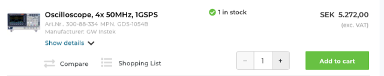

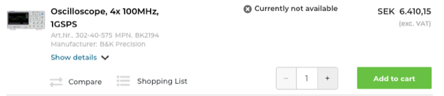

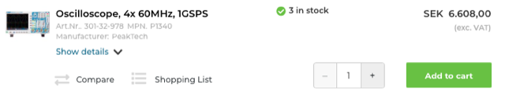

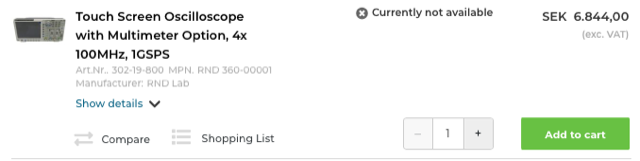

> *GW Instek*  
> *Oscilloscope, 4x 50MHz, 1GSPS Art.Nr.. 300-88-334MPN. GDS-1054B Manufacturer: GW Instek 5272 SEK*

> *B&K Precision*  
> *Oscilloscope, 4x 100MHz, 1GSPS Art.Nr.. 302-40-575MPN. BK2194 Manufacturer: B&K Precision SEK 6.410,15*

> *PeakTech*  
> *Oscilloscope, 4x 60MHz, 1GSPS Art.Nr.. 301-32-978MPN. P1340 Manufacturer: PeakTech SEK 6.608,00*

> *RND Lab*  
> *Touch Screen Oscilloscope with Multimeter Option, 4x 100MHz, 1GSPS Art.Nr.. 302-19-800MPN. RND 360-00001 Manufacturer: RND Lab SEK 6.844,00*

> *Teledyne LeCroy*  
> *Oscilloscope, 4x 100MHz, 1GSPS Art.Nr.. 301-18-737MPN. T3DSO1104 Manufacturer: Teledyne LeCroy SEK 11.372,00*

> *Keysight*  
> *Oscilloscope, 4x 70MHz, 2GSPS Art.Nr.. 301-29-273MPN. DSOX1204A Manufacturer: Keysight **SEK 14.157,00*

> *Rohde & Schwarz*  
> *Oscilloscope, 4x 70MHz, 1.25GSPS Art.Nr.. 300-82-457MPN. RTB2K-74 Manufacturer: Rohde & Schwarz SEK 26.085,00*

2) Consider the lowest priced ones on [electrokit.se](http://electrokit.se)?

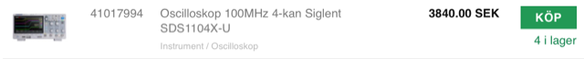

> *Oscilloskop 100MHz 4-kan Siglent SDS1104X-U **3840.00 SEK*

3) Consider the lowest priced ones on [farnell.com](http://farnell.com)?

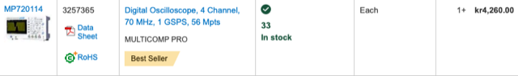

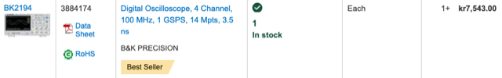

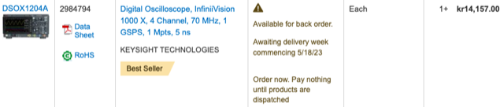

> *MULTICOMP PRO*  
> *MP720114 Digital Oscilloscope, 4 Channel, 70 MHz, 1 GSPS, 56 Mpts kr 4,260.00*

> *B&K PRECISION*  
> *BK2194 Digital Oscilloscope, 4 Channel, 100 MHz, 1 GSPS, 14 Mpts, 3.5 ns **7,543.00*

> *KEYSIGHT TECHNOLOGIES *  
> *DSOX1204A Digital Oscilloscope, InfiniiVision 1000 X, 4 Channel, 70 MHz, 1 GSPS, 1 Mpts, 5 ns **14,157.00*

4) Consider the lowest priced ones on rs-online ([se.rs-online.com](http://se.rs-online.com) )?

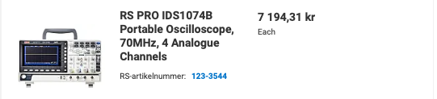

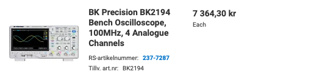

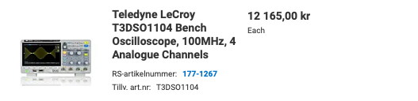

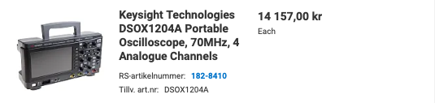

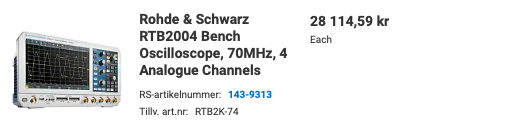

> *RS PRO*  
> *IDS1074B Portable Oscilloscope, 70MHz, 4 Analogue Channels **7 194,31 kr*

> *BK Precision*  
> *BK2194 Bench Oscilloscope, 100MHz, 4 Analogue Channels 7364 kr*

> *Teledyne LeCroy*  
> *T3DSO1104 Bench Oscilloscope, 100MHz, 4 Analogue Channels With RS Calibration 12165 kr*

> *Keysight Technologies *  
> *DSOX1204A Portable Oscilloscope, 70MHz, 4 Analogue Channels 14 157 kr*

> *Rohde & Schwarz *  
> *RTB2004 Bench Oscilloscope, 70MHz, 4 Analogue Channels **28 114,59 kr*

5) Consider the lowest priced ones on [mouser.se](http://mouser.se)?

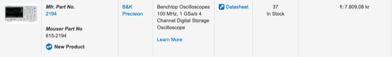

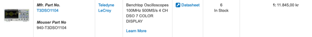

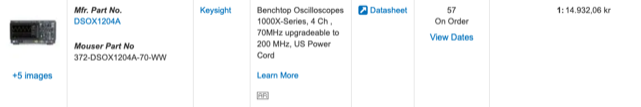

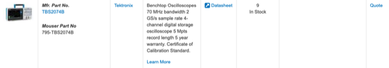

  
> *B&K Precision*  
> *Model 2194 4-Channel Digital Storage Oscilloscope **7.809,08 kr*

> *Teledyne LeCroy*  
> *T3DSO1000 / T3DSO1000A Oscilloscopes **11.845,00 kr*

> *Keysight Technologies*  
> *DSOX1204 4-channel Oscilloscopes **14.932,06 kr*

> *Tektronix TBS2000B*  
> *Digital-Storage Oscilloscopes Quote kr*

> *...*

6) Consider the lowest priced ones on [conrad.se](http://conrad.se)

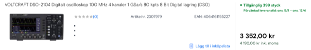

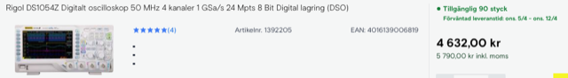

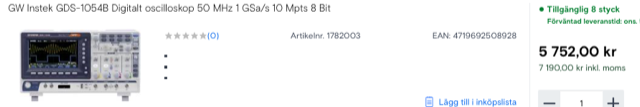

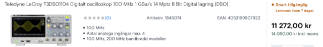

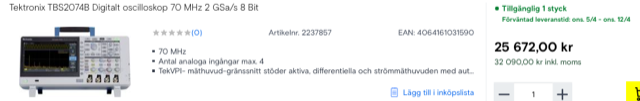

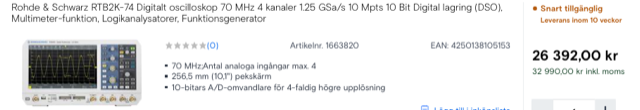

> *VOLTCRAFT*  
> *DSO-2104 Digitalt oscilloskop 100 MHz 4 kanaler 1 GSa/s 80 kpts 8 Bit Digital lagring (DSO) 3352 kr*

> *Rigol*  
> *DS1054Z Digitalt oscilloskop 50 MHz 4 kanaler 1 GSa/s 24 Mpts 8 Bit Digital lagring (DSO) 4632 kr*

> *GW Instek*  
> *GDS-1054B Digitalt oscilloskop 50 MHz 1 GSa/s 10 Mpts 8 Bit 5752 kr*

> *Teledyne LeCroy*  
> *T3DSO1104 Digitalt oscilloskop 100 MHz 1 GSa/s 14 Mpts 8 Bit Digital lagring (DSO) 11 272 kr*

> *Tektronix*  
> *TBS2074B Digitalt oscilloskop 70 MHz 2 GSa/s 8 Bit 25 672 kr*

> *Rohde & Schwarz*  
> *RTB2K-74 Digitalt oscilloskop 70 MHz 4 kanaler 1.25 GSa/s 10 Mpts 10 Bit Digital lagring (DSO), Multimeter-funktion, Logikanalysatorer, Funktionsgenerator 26 392 kr*

...


