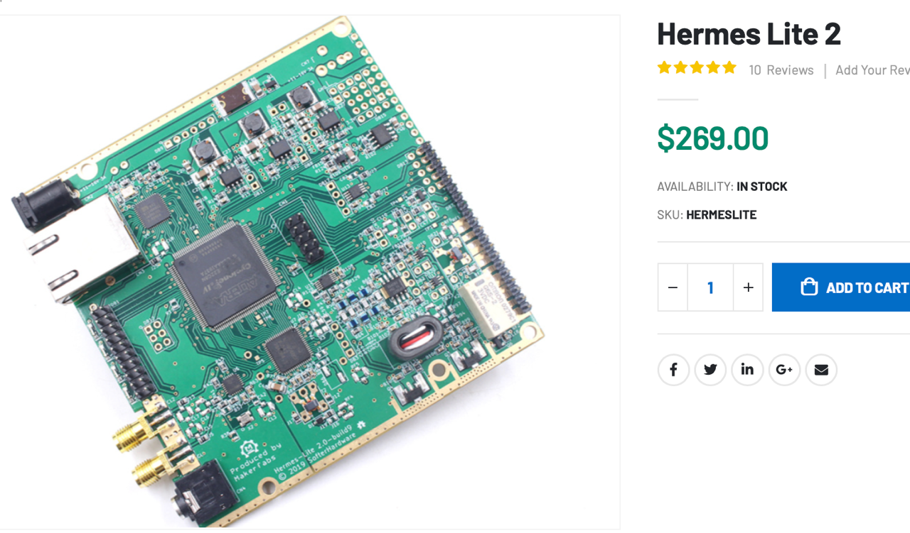

# Todo: Consider to delve into Lora based Reticulum open source P2P self organising networks?

```#e0742d3a``` *As of 2026-09-23 11:04*

[mail plain/text](mail.txt)


I want to explore self organising (emergent oriented) social development and technologies.

1) Consider youtube video "The Open Source Internet Is Here" (<https://youtu.be/5vbl5FL-nsI> )?

==&gt; Consider the "PARALLEL BY DATA SLAYER" web site (<https://buildwithparallel.com> )?

> *"**Field-tested guides for mesh radios, Wi-Fi HaLow, Reticulum, ATAK, and local-first networks using open-source tools and commodity hardware**"*

==&gt; Consider the links in the video description?

> "  
> Parallel Primer — the course for how the hardware, radios, and software fit together:  
> 👉 [https://buildwithparallel.com/product...](https://www.youtube.com/redirect?event=video_description&redir_token=QUZZTVljRUVHU0hOSjZUb2luazUzSTZzc29TVnxBTl9pYzRjdUZhODVPQUJVV2dNVkU4dXNaVlRONGRfQnFRb2pRenNuZUJ4dndsdHU5Wlg0U0w3QzBERVJpMG80NE9OMUNCbmwyNjM1V1BkMXFrd1pGQnZIelNUaXpqWmJXY0d4&q=https%3A%2F%2Fbuildwithparallel.com%2Fproducts%2Fparallel-primer%3Futm_source%3Dyoutube%26utm_medium%3Dvideo%26utm_campaign%3Dreticulum-hf-bridge%26utm_content%3Ddescription&v=5vbl5FL-nsI)

> Haven — the node I use in the field:  
> 👉 [https://buildwithparallel.com/product...](https://www.youtube.com/redirect?event=video_description&redir_token=QUZZTVljR0lDQmVCaGVwQzAwX0RmUnZRcHBNVXxBTl9pYzRlWl9mVU85ZV8zTHktbkU5bFNybVlIT2tybXVEeWpxX0F1VjNEZDhOQnVIR1FxZFloQVpNRVcwdWNNeHcwR1pCMDBteUFIRk5uNUpxc2pNZWpUM0RCa2U4cnZWbV94&q=https%3A%2F%2Fbuildwithparallel.com%2Fproducts%2Fhaven%3Futm_source%3Dyoutube%26utm_medium%3Dvideo%26utm_campaign%3Dreticulum-hf-bridge%26utm_content%3Ddescription&v=5vbl5FL-nsI)

> CrossTalk: Reticulum Workbench  
> [https://github.com/buildwithparallel/...](https://www.youtube.com/redirect?event=video_description&redir_token=QUZZTVljSF91NlhFb3hNTG55YkZxMGFocGY2dnxBTl9pYzRjV2p0cXkxWFNFdDNDc1RrS2ZwN245UkhmOG5HaDZSUUJtZkxKZzJLdFJLbTRaV3d4UmpBUlRZaUlFUEozOV9MUXBBd0RCMFQ0V2kzUUdtWUUxUnBwSFQ3S0ptVW5F&q=https%3A%2F%2Fgithub.com%2Fbuildwithparallel%2Fcrosstalk&v=5vbl5FL-nsI)  
> "

==&gt; What is Wi-Fi HaLow?

==&gt; Consider Wikipedia article "IEEE 802.11ah" (<https://en.wikipedia.org/wiki/IEEE_802.11ah> )?

> > *"**IEEE 802.11ah is a wireless networking protocol called Wi-Fi HaLow&#91;1&#93;&#91;2&#93;&#91;3&#93; (/ˈheɪˌloʊ/) published in 2017&#91;4&#93; as an amendment of the IEEE 802.11-2007 wireless networking standard.*

> > *...*

> > *The protocol's low power consumption competes with Bluetooth, LoRa, Zigbee, and Z-Wave,&#91;6&#93;&#91;7&#93; and has the added benefit of higher data rates and wider coverage range.*

> > *"*

==&gt; What is Reticulum?

==&gt; Consider the "Reticulum Network Stack Manual" web site (<https://reticulum.network/manual/whatis.html> )?

> > *"**What is Reticulum?*

> > *Reticulum is a cryptography-based networking stack for building both local and wide-area networks with readily available hardware, that can continue to operate under adverse conditions, such as extremely low bandwidth and very high latency.**"*

==&gt; What is ATAK?

==&gt; Consider wikipedia article "Android Team Awareness Kit" (<https://en.wikipedia.org/wiki/Android_Team_Awareness_Kit> )?

> > *"**Android Team Awareness Kit (ATAK, also as Android Tactical Assault Kit, and Android Tactical Assault Kit for Civilian Use, ATAK-CIV) is an Android smartphone geospatial infrastructure and military situation awareness app. It allows for precision targeting, surrounding land formation intelligence, situational awareness, navigation, and data sharing.**"*

==&gt; What is "local-first networks"?

==&gt; Consider "SBN - Sustainable Business Network of Massachusetts" web site (<https://www.sbnmass.org> )?

> > *"About SBN*

> > *SBN was founded in 1988 as the nation’s first business trade association with a mission of making business a vehicle for social, environmental, and economic change."*

==&gt; Consider "Amiba - American Independent Business Alliance" web site (<https://amiba.net> )?

> > *"**AMIBA was founded in 2001 as part of a nationwide movement to support locally-owned, independent businesses, encourage local purchasing, and address the competitive disadvantages that independent businesses often experience due to policies and economic structures.**"*

==&gt; What "open-source tools" exists?

==&gt; What "commodity hardware" exists?

2) Consider the Makerfab low-cost direct down/up conversion software-defined amateur radio HF transceiver "Hermes Lite 2" (<https://www.makerfabs.com/hermes-lite-2.html?srsltid=AU7gw4XQiklnem-ZAWpr25ldf8xs8MDgr3-v6wZyEjgy0me1MOVm2oWk> )?



...


