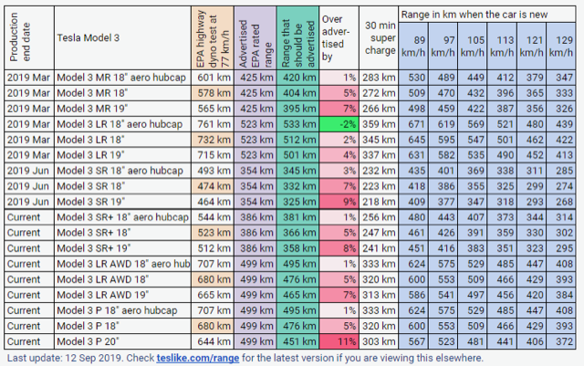

# Todo: Consider what it means that a Tesla Model 3 requires around 208 Wh/Km wile a Tesla Model X requires 290 Wh/Km?

```#e2a12a93``` *As of 2020-01-07 11:32*

[mail plain/text](mail.txt)


I want to get to grips with the power consumption of cars in general and electric cars in specific and I can thus use the Wh per Km information to delve into these physics realities.

-1) Consider some bottom line "guesses" that can be valuable heuristics about electric car power efficiency?

==&gt; We may guess that car charging overhead is around 250W regardless of charge rate which means we should aim at high charge rates for high efficiency?

> *If we always loose 250W in the charge circuitry we must aim to get the charge overhead to charge power ration as low as possible. So "trickle charging" at 1500 Kw would mean we only get 1500 - 250 = 1250W into the battery. This is itself a 250/1500 = 17% power loss! If we then add another 5% loss for the charging process itself we loose 22% compared to the AC power we used as input. Speculating that DC charge to AC consumption for the energy storage battery (power wall) installation has an 80% efficiency (DC in charge to AC out discharge) we have to harvest (20% + 22% + 3%) = 47% more than we can discharge for travel in the car. Or put another way, we have to cover for 20% loss in the round trip DC charge to AC consumption of the energy storage battery pack. Then cover the additional 22% that is lost in the 250W overhead of the Tesla charging system. And finally cover for the 3% loss of the actual round trip of the energy in and out of the Tesla car battery.*

> *But the higher the rate we can charge the car the lower the 250W overhead will toll on the energy that goes into the battery.*

> *But then we actually not yet know how a higher charge rate will affect the DC to AC efficiency of the energy storage. Will the assumed 20% loss go up or down for the energy consumption we draw from the storage?*

> *...*

1) Consider the youtube video "Model 3 vs Model X from Oslo to Trondheim" (<https://youtu.be/XW4z0CBzqro> )?

==&gt; At around 3:33 they expose their current power consumption on the road to Trondheim for a Model 3 and a Model X (<https://youtu.be/XW4z0CBzqro?t=213> )

> *So at this point in time they report the Model 3 to have averaged 208 Wh / Km for the Model 3 and 290 Wh/Km for the Model X.*

> *Now, they had travelled 19 km in 12 minutes which average to 19 km/0,2h = 95 km/h.*

> *This means they averaged each km in 60\*60 s/95 km = 37,9 s.*

> *So the power consumption is thus the X Wh / 37,9 s which for the Model 3 is 208 Wh / 37,9 s = 208 Wh \* 60 Minutes \* 60 Seconds Ws / 37,9 s = 748 800 Ws/37,9 s = **19 757 W** and for the Model X is 290 Wh \* 60 minutes \* 60 seconds Ws/37,9s = **27 546 W**.*

2) Consider the range listings for Tesla electric cars at [Teslike.com](http://Teslike.com) (<https://teslike.com/range/> )?

==&gt; It seems to me that the range listing is hard to use to determine the car power consumption and efficiency?

>   
> *Tesla Model 3 range listing at <https://teslike.com/range/>*

> *Now, the range of the car depends not only on its actual power consumption but also at the available energy in the installed battery. So figuring out how far I may travel for each harvested Wh from say a solar or wind energy farm at my property is not straight forward.*

3) Consider the factors and physical reality that determines how far I can travel with an electric car for each Wh I harvest from a wind or solar farming installation?

==&gt; Q: What is the efficiency factor for charging batteries from Solar or Wind?

A: It seems the round-trip efficiency of a Lithium Ion energy storage solution can be as good as 95% meaning the available discharge energy is 95% of what we used to charge it.

> <https://batterytestcentre.com.au/project/lithium-ion/> : "*The ratio of the energy required to charge a battery compared to the available energy during discharge is referred to as the efficiency. A typical lithium ion battery will lose only 5% of energy round-trip*"

==&gt; Consider the AC/AC Efficiency of different energy storage solutions (<https://energymag.net/round-trip-efficiency/> )?

> Storage technologiesRound trip efficiencyHydrofrom 65% in older installations to 75-80% for modern deploymentsFlywheels80% to 90%Batteries75% to 90%Electrothermal (ETES)65% to 75%Compressed air (CAES)65-75%

==&gt; It seems to me we have to compare harvest to intermediate battery and harvest directly to car to know what is "best" or how much we need to harvest to travel a certain distance?

> *So worst case should be to first harvest solar or wind into a storage battery pack like a "power wall". And then use an inverter to drive the car charger with AC current. Now if the information I have found is correct it seems I can expect to be able to retrieve up to 95% of the stored energy from a Lithium Ion pack. Not I am not sure I can trust those figures. On top of that we then have the losses in the inverter and then in the charge process in the car.*

Q: What is the charge efficiency of a Tesla Model 3?

A: From a quick web search I get that the Tesla charge efficiency is 97% with a somewhat fixed overhead of 250 W?

> <https://teslamotorsclub.com/tmc/threads/charge-efficiency-chart-from-our-model-3.174044/> : *"**I did a very **slow charge** at 5A over the weekend able 90% and whoa, that was really **inefficient** around **65%** or something. **"*

> *"...**there is an "overhead" cost of power when charging so the less time you charge, the less you have to pay in "overhead costs"**"*

> *"* *...overhead doesn't seem to increase with higher charge rates**"*

> *"**I would just use a model for the charging efficiency for your purposes (**250W overhead and 95% AC-DC efficiency** for a **quick guess**) and leave it at that. It is true that this efficiency number accounts for some cabling losses so the actual conversion efficiency may be slightly higher.**"*

...


