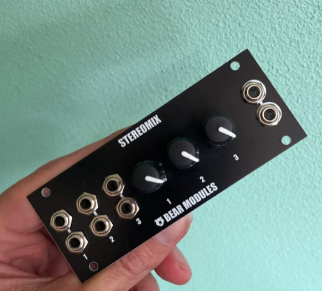
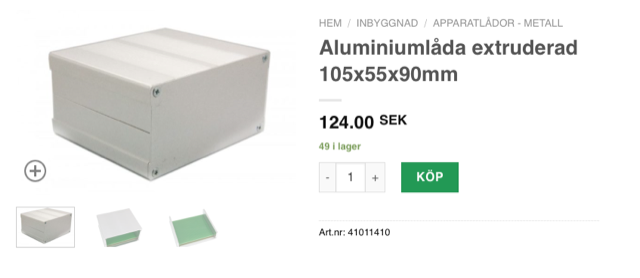

# Todo: Consider to understand the "Eurorack" format used for modular synthesizers and accessories?

```#e2aaf207``` *As of 2024-02-18 20:00*

[mail plain/text](mail.txt)


I may end up building my own 3 channel stereo mixer from modular synth parts and thus need to map Eurorack notations to the real world.

1) Consider wikipedia article on "Eurorack" (<https://en.wikipedia.org/wiki/Eurorack> )?

==&gt; It seems Intellijel 1U height is defined as 39,65 mm?

> *"**Several manufacturers offer Eurorack-compatible modules in a smaller 1U tall format, sometimes referred to as "tiles". As of 2018, there are two competing standards for 1U modules, differing mainly in their height. 1U modules manufactured by Intellijel are 39.65 mm high,&#91;23&#93; whereas 1U modules manufactured by Pulp Logic and other manufacturers are 43.2 mm high.&#91;24&#93; Pulp Logic also proposes a more compact power connector for 1U modules, consisting of only three pins.**"*

==&gt; It seems the standard Eurorack sizes are defined in 3U (rack units) of 128.5 mm or 133,3 (without and with lip) and 1HP (Horizontal pitch) of 5,08 mm?

> *"*  
> *The physical specification is based on the Eurocard standard of: *

> *• 3U (5.06 inches or 128.5 mm), where height "U" is measured in rack units, rounded for a lip (nb: 3U in standard rack units would be 5.25 inches or 133.3 mm).  
> *

> *• 1HP (0.2 inches or 5.08 mm), where width "HP" is measured in horizontal pitch units. A card width is generally integer multiples of 1HP, although some manufactures work in multiples of 0.5HP.&#91;21&#93;"*

2) Consider ChatGPT answer to map 20 HP 1U Intellijel rack sizes into mm (<https://chat.openai.com/share/ea6d384b-7c57-4b7c-b63b-ff2629811008> )?

> *"**I have a eurorack module for intellijel frames defined as being of size 20 HP 1U. What are the size 20 HP 1U eurorack size in mm?**"*

> *"**In Eurorack modular synthesizer systems, 1HP (horizontal pitch) is equivalent to 5.08 millimeters (mm). Therefore, to find the size of a module in mm, you would multiply the HP by 5.08.*

> *For a module that is 20HP wide:

> 20 HP \* 5.08 mm/HP = 101.6 mm

> So, a Eurorack module that is 20 HP wide would be 101.6 millimeters wide.

> Regarding the "1U" designation, that refers to the vertical height of the module. In Eurorack, 1U is typically equivalent to 1.75 inches (44.45 mm). So, a 1U module would be 44.45 mm tall. Therefore, a 20 HP 1U module would be 101.6 mm wide and 44.45 mm tall.**"*

==&gt; I asked ChatGP for clarification regarding the conflicting information in the wikipedia article above.

> *"**But in a wikipedia article I read "1U modules manufactured by Intellijel are 39.65 mm high,". Is this true?"*

> *"Yes, you are correct. I apologize for the oversight. Intellijel indeed manufactures 1U modules with a height of 39.65 mm, which is slightly different from the standard 1U height of 44.45 mm.

> Therefore, for an Intellijel 1U module:

> *  
> *Width: 20 HP \* 5.08 mm/HP = 101.6 mm*  
> *Height: 39.65 mm*

> *So, a 20 HP 1U Intellijel module would be 101.6 mm wide and 39.65 mm tall. Thank you for bringing that to my attention.**"*

3) Consider the actual front plate size of this ([https://www.etsy.com/se-en/listing/1479300790/stereomix-1u-eurorack-stereomixer?click_key=0c54c4a7ab8dbf529149e1448edd49b4a6e58791%3A1479300790&click_sum=cdd9feb2&ref=shop_home_recs_2&crt=1&sts=1&variation0=3937279515](https://www.etsy.com/se-en/listing/1479300790/stereomix-1u-eurorack-stereomixer?click_key=0c54c4a7ab8dbf529149e1448edd49b4a6e58791:1479300790&click_sum=cdd9feb2&ref=shop_home_recs_2&crt=1&sts=1&variation0=3937279515) )?



20HP, 1U intellijel-format, Power consumption 12v 10mA; -12v 0mA; 5v 0mA

==&gt; This would mean the front plate is 20 x 5,08 times 1 \* 39,65 = 101,6 times 39,65?

==&gt; Thus I should be able to mount it in a whole made on the front of this aluminium box (<https://www.electrokit.com/produkt/aluminiumlada-extruderad-105x55x90mm/> )?



...


