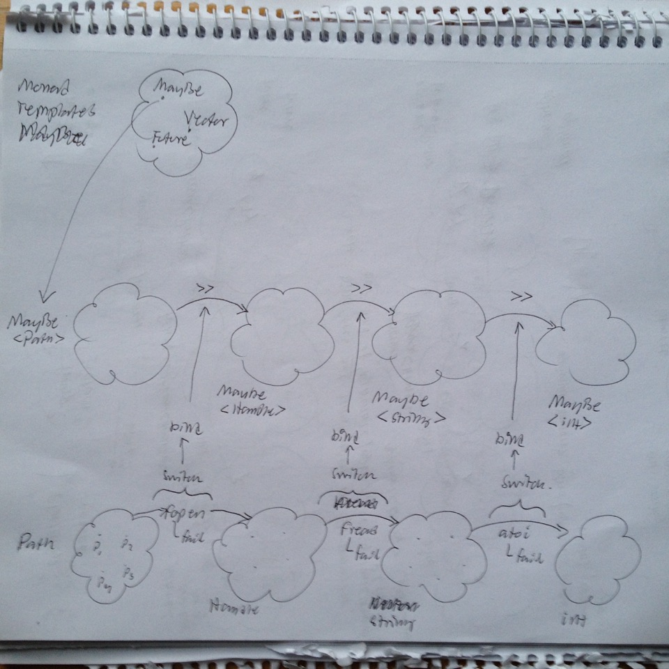

# Todo: Programming - Consider to understand Monoids and Monads using the "Railway Oriented Programming" model?

```#e359b4d0``` *As of 2017-01-13 15:36*

[mail plain/text](mail.txt)


It seems the "Railway Oriented Programming" idiom (model) as talked about by Scott Wlaschin may be a good way to reason about and understand how monads and monoids are used in programming?

1) Consider this talk by Scott Wlaschin (<https://vimeo.com/97344498>)?

==&gt; It seems the Monad here is the ”two track” (happy and error path) function made from single path function?

result_type f(input_type) ==&gt; Monad&lt;result_type&gt; Monad&lt;input_type&gt;::bind?

==&gt; At 14:30 he makes funny references to the Monads ”Maybe” and ”Either” :)

==&gt; When you want to chain together function calls but handle errors as well - Use a Monad!

==&gt; Seems to rime well with a mathematical monad being about defining an Algerbra for a Category?

==&gt; The ”Algebra” here is how and when to call the functions?

==&gt; At 17:45 he defines functions as transformations between Sets (value level)


==&gt; This is exactly my ”value level” where functions maps values of one Set to another set of Values!

==&gt; At 20:55 he describes how to glue together functions that takes one thing but returns two (success or failure)


==&gt; And uses the analogy to make a new function that actually also takes two inputs!


==&gt; He defines bind as what takes a ”maybe returning function” (a switch) into ”maybe input and return function”.


==&gt; And this is the Monad?

==&gt; Thus bind makes ”switch” functions (functions that may fail and thus can’t be composed) into compose-able ”two-track” functions

==&gt; Thus bind takes a switch-function and returns a two-track-input function?


...

==&gt; Then we may use bind on each switch and compose the resulting two-track functions


==&gt; It seems operator&gt;&gt;(two-track-output, two-track-inout-function) and returns two-track-output (the result of calling the two-track-input function with the two-track-input value)

==&gt; two-track-output operator&gt;&gt;(two-track-inout, two-track-input-function) { return two-track-inout-function(two-track-input)}?

==&gt; We may now defined a composed two-track function


==&gt; Which we may write more clearly by defining "&gt;&gt; bind" as the &gt;&gt;= operator

==&gt; It seems if operator&gt;&gt;(two-track-result, two-track-input-function) and returns a two-track-output result,…

==&gt; It actually seems to rime very well with this github C++ monad project (<https://gist.github.com/brotchie/3134600>)?


> > template &lt;template &lt;typename...&gt; class F, typename A, typename B&gt;  
> > static F&lt;B&gt; **operator &gt;&gt;**(F&lt;A&gt; a, F&lt;B&gt; b) {  
> > function&lt;F&lt;B&gt;(A)&gt; f = &#91;b&#93;(A){ return b; };  
> > return a &gt;= f;  
> > }

==&gt; BUT: This definition is LAZY! (It actually takes the ”previous” two-track-input function F&lt;A&gt; and returns the new two-track-output function F&lt;B&gt;?

==&gt; Then operator&gt;&gt;=(two-track-result, switch-function) and returns a two-track-output result?

==&gt; i.e. operator&gt;&gt;= knows how to make not-composable switch-fucntions into composable two-track-inout functions?


==&gt; In C++ this seems to be ?? operator&gt;&gt;=(twoTrackInput, SwitchFunction) (Still a bit unclear what it returns)?

==&gt; Is seems map is just like bind but it takes single-track functions instead of switch functions?


==&gt; he also states that ”**map**" is sometimes called ”**lift**”

==&gt; This seem to be the ”fmap” of the Functor in the github project ()?

> > static function &lt;Maybe&lt;B&gt;(Maybe&lt;A&gt;)&gt; fmap(function &lt;B(A)&gt; f) {  
> > return &#91;f&#93;(Maybe&lt;A&gt; m) -&gt; Maybe&lt;B&gt; {  
> > if (m.isNothing()) {  
> > return Maybe&lt;B&gt;();  
> > } else {  
> > return Maybe&lt;B&gt;(f(m.fromJust()));  
> > }  
> > };  
> > };

==&gt; In this case creates a function that creates **two-track&lt;B&gt; from two-track&lt;A&gt; using single track function B(A)**

==&gt; It seems ”return” turns a two-track-output back to single-track-output?


2) Consider to reason about chained error handling as functions that passes the error and the result through between functions to enable them to detect errors?

==&gt; Consider we want to call g with the result of f (but f may fail to produce a result)?

==&gt; How do we write our code so that g gets called only if f returns a value?

1) Create a new function F that uses f to create a ”Maybe&lt;f_result&gt;”

2) Create a new function G that takes a Maybe&lt;f_result&gt; and calls g only if f_result has a value?

...

3) Consider how the Railway Oriented Programming idiom maps to my proposal of three layer value, monad, template model?

==&gt; Q: **This is not quite there yet!**

==&gt; Q: What should we call the function returned by bind (To make this model work we need a way to refer to the value-inout monadic-value output function created by bind)?



==&gt; (1) It seems we first need to turn our fopen, fread, atoi into switch-functions (or are they already switch functions)?

==&gt; Switch_F&lt;fopen&gt; takes a Path and returns a Maybe&lt;Handle&gt;

==&gt; Q: **What do we call the operation that creates a switch-function from the ”raw” function?**

…

==&gt; (2) Then bind will take an F&lt;fopen&gt; and return an F&lt;Maybe&lt;Path&gt;&gt;, a function that returns a Maybe&lt;Handle&gt;

==&gt; bind turns a switch function F&lt;fopen&gt; into a composable two-track-input and output function

==&gt; Q: The model is still ”wrong” in that it does not show the laziness of composition (the actuall function calls does not occur until we call the created composed function (i.e. from Path to Maybe int)?

...

4) Consider to read the ”original” Monad paper (<http://homepages.inf.ed.ac.uk/wadler/papers/marktoberdorf/baastad.pdf>)?

==&gt; Also reachable through [bit.ly/monad-paper](http://bit.ly/monad-paper)

==&gt; It seems it defines a Monad type M quite good!

> ”*The original evaluator has the type Term → Int, while in each variation its type took the form Term → M Int. In general, a function of type a → b is replaced by a function of type a → M b. This can be read as a function that accepts an argument of type a and returns a result of type b, with a possible additional effect captured by M. This effect may be to act on state, generate output, raise an exception, or what have you.*"

==&gt; Replace ”plain” function **a —&gt; b** with a function **a —&gt; M b** (i.e., the monadic value of b)

==&gt; And the monadic type M must be able to do two things to accomplish this.

> ”***First**, we need a way to turn a value into the computation that returns that value and does nothing else.*

> ***unit :: a → M a***"

> ”  
> **Second**, we need a way to apply a function of type a → M b to a computation of type M a. It is convenient to write these in an order where the argument comes before the function.

> **(⋆) :: M a → (a → M b) → M b**"

==&gt; The Monad may then be defined.

> ”A monad is a **triple (M,unit,⋆)** consisting of a type constructor M and two operations of the given polymorphic types.”

> ==&gt; (1) We must be able to construct the type M (in C++ we use a template for this, e.g., the template ”Maybe” and we construct the Monad type with Maybe&lt;Handle&gt;, Maybe&lt;string&gt; etc…)  
> ==&gt; (2) We need the ”unit” where we may instantiate the monadic value given the ”plain” value (In C++ we may call the constructor, e.g., Maybe&lt;Handle&gt;(handle), Maybe&lt;string&gt;(”Hello”)…)  
> ==&gt; (3) We need a function that uses the a —&gt; M b to turn M a to M b.

> ==&gt; This function is created by bind!  
> ==&gt; **Q: But where do we get our a —&gt; M b?**

… It seems we need to **learn the semantics** to read this paper (it seems to be some mix of mathematical symbols and computer science symbols)? …

…

Consider to delve deeper into this approach of understanding the ”Railway Oriented Programming” model in terms of Monad and Monoid terms?

...


