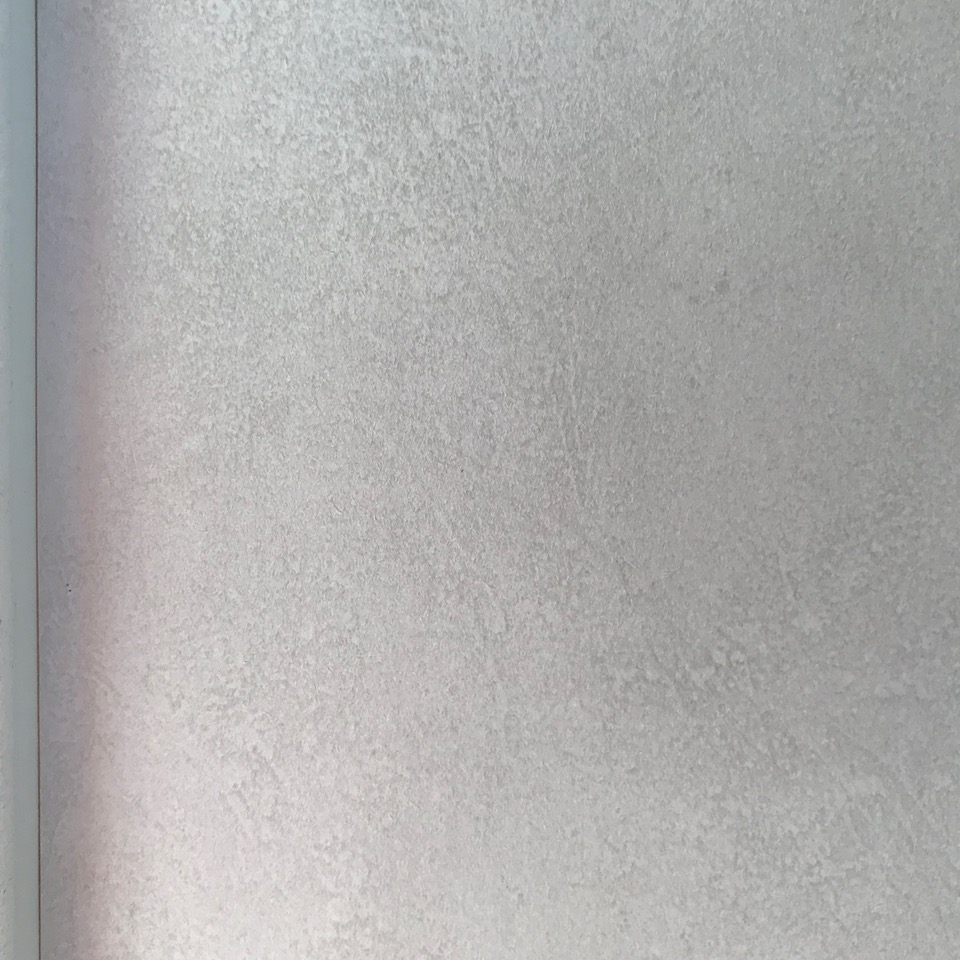
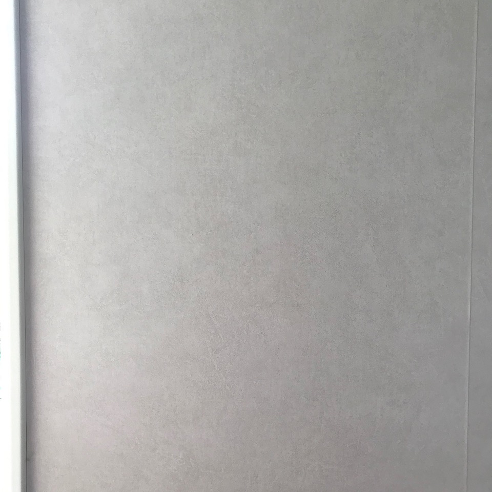
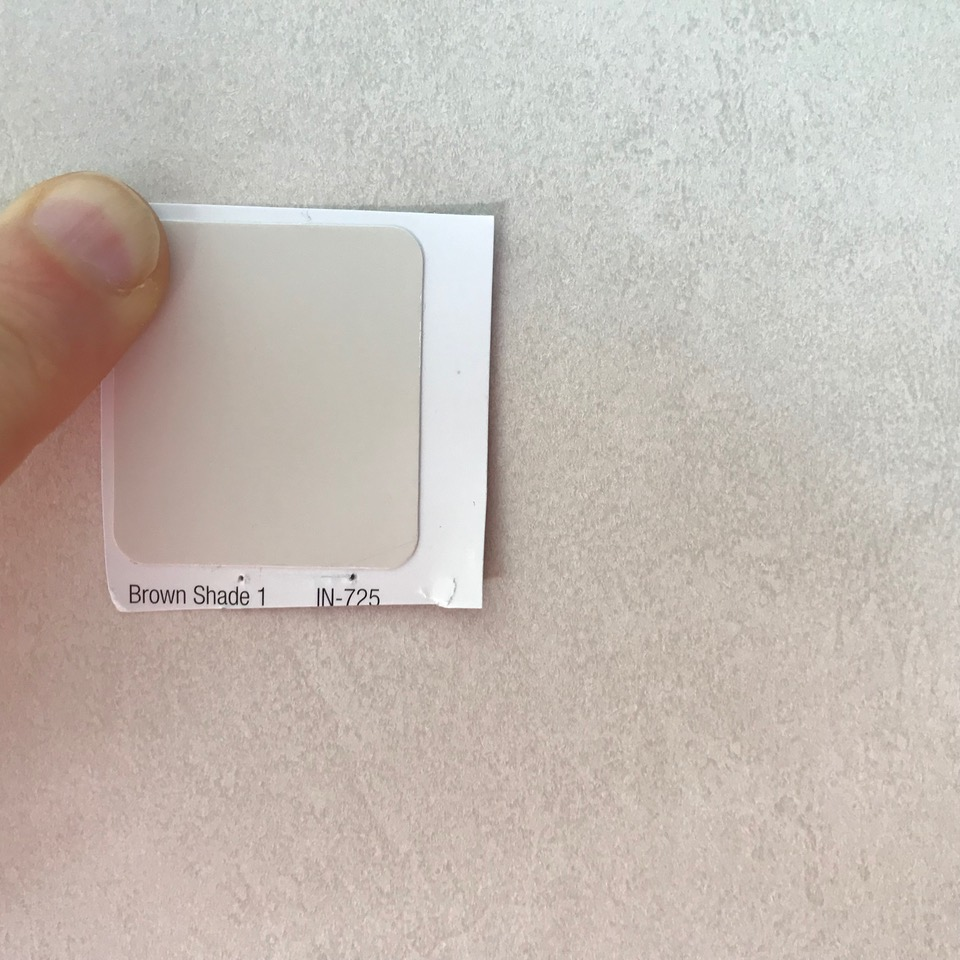
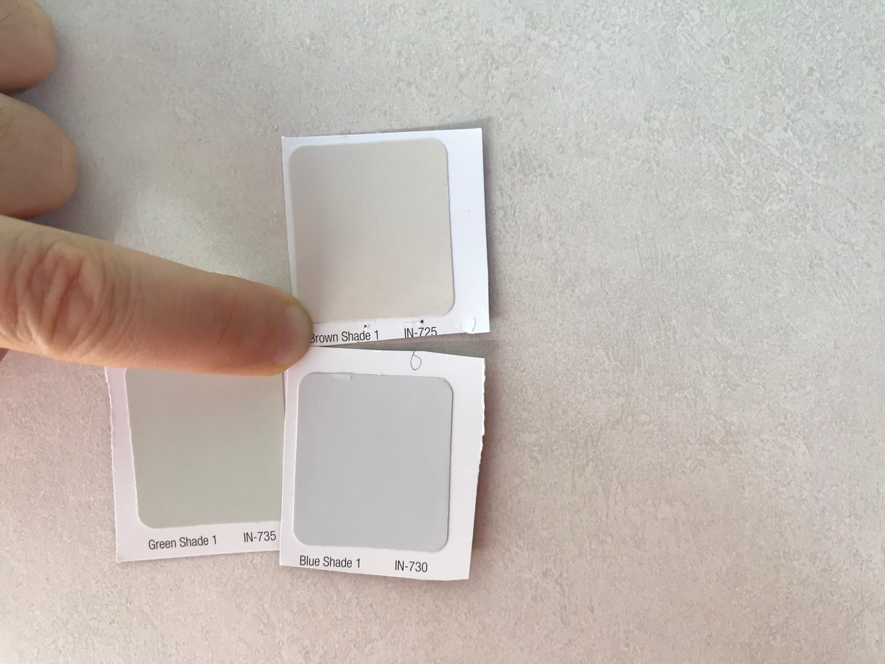

# Todo: Wall Painting - Consider to delve into sponge and faux painting options to optionally try out to have my painted walls look more "alive"?

```#e4b81404``` *As of 2019-06-06 13:52*

[mail plain/text](mail.txt)


Are there some simple faux or sponge painting techniques I can try out on my home walls to paint them so they appear more "alive" (not so flat and dull)?

==&gt; Also see "[Todo: Wall Painting - Consider to use Lime Wash (Swedish Kalkfärg) on my tv-room wall to get a more "alive" texture?](../841c8fe8/chime.md)"

==&gt; Also see "[Todo: Wall Painting - Consider to what degree the NCS Colour System is a colur coding system I can use to define colour of paint I buy from different vendors?](../eb03bfc9/chime.md)"

1) Consider my existing wall paper in the room actually has a "spongy" pattern applied to them?

==&gt; It seems my existing wall paper is a high tone on top af a low base (light on dark)?

==&gt; My existing wall paper seems to have a reddish touch (where does it come from)?



*My existing wall paper "sponge" pattern close-up as pronounced by my iPhone camera (it is more subtle to the eye)*



*My existing wall paper "sponge" pattern full roll width as pronounced by my iPhone camera (it is more subtle to the eye and note the reddish touch)*



*My existing wall paper seems to have colours close to "Brown Shade 1" as defined by IN-725 code by Flügger*



*It is a tricky thing to capture colours with a camera but these three nuances are in the neighbourhood?*

2) Consider wikipedia on Faux Painting (<https://en.wikipedia.org/wiki/Faux_painting> )?

3) Consider youtube videos about faux and sponge paintings?

==&gt; Consider the youtube video "The Retro-Metro a Metallic Paint Faux Finishing Technique" (<https://www.youtube.com/watch?v=oHOfJu57SCs&t=6s> )?


==&gt; Consider the youtube video "Textured Metallic Wall Finish" (<https://www.youtube.com/watch?v=AdVmnJDTNEg> )?


*Example of faux metallic painted wall (<https://youtu.be/AdVmnJDTNEg?t=16> )*

==&gt; Consider the youtube video "How to Sponge Paint a Wall | Paint Techniques" (<https://www.youtube.com/watch?v=n2XaGFLw-xk> )?

==&gt; She seems to suggest to apply first the mid tone, then the low tone and finally the high tone?


*Example of sponge painting (<https://youtu.be/n2XaGFLw-xk?t=116> )*

...


