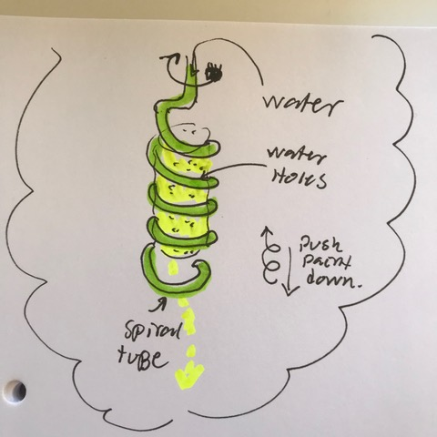

# Todo: Consider a rotating water dispenser spiral tube for a paint roller percolation cleaner design?

```#e5df80c3``` *As of 2019-04-30 13:23*

[mail plain/text](mail.txt)


It seems we can come up with some clever percolation mechanism to clean rollers from water based paint?

==&gt; Also see "[Todo: Consider an acrylic tube based hinged compartment tower for screws and nuts and other fasteners and small things?](../381b798e/chime.md)"

==&gt;

1) Consider a spiral that squeezes the paint out of the roller while rotating and at the same time dispenses water for paint extraction using percolation?

==&gt; Consider some designs of a spiral tube with water dispensing and paint-squeeze operation?



*Water tube and dispenser spiral to squeeze and percolate the paint out of a roller*

2) Consider we can try to bend and drill holes in transparent acrylic pipe?

==&gt; Consider we can by acrylic pipe for heat-bending (e.g. <https://www.materialbutiken.se/produkt/akrylror-klar-50010-6mm/> )?


==&gt; Consider me may consider to drill the holes in the acrylic tube after bending it (should it twist during bending making the holes point outwards instead of inwards)?

==&gt; Consider how we can heat and bend the pipe into a spiral while keeping the inside diameter of the tube intact (use a silicone rod inside the tube)?

...


