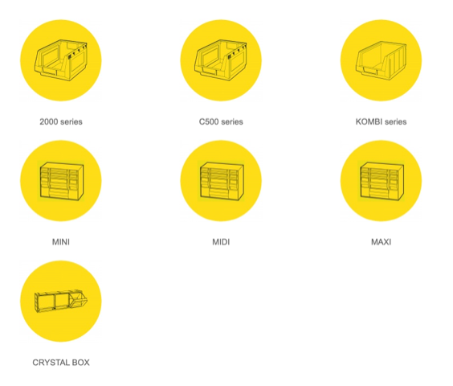
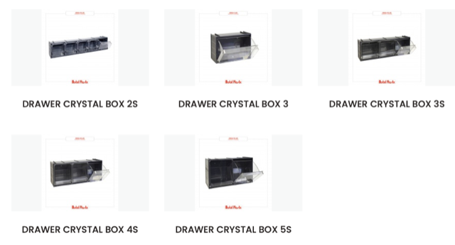
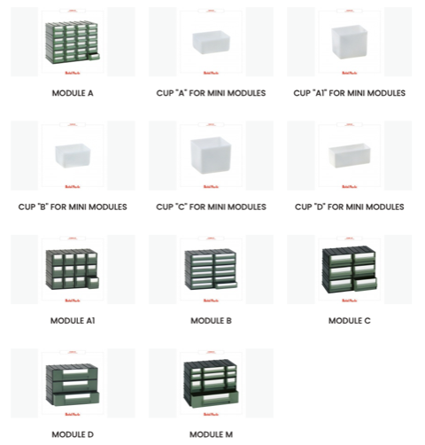

# Todo: Consider storage modules for my electronics lab from Italian Mobil Plastic S.P.A?

```#e6782b52``` *As of 2024-03-13 11:44*

[mail plain/text](mail.txt)


I need convenient and "compact living" storage solution for my electronics lab and indoor storage.

1) The Italian "Mobil Plastic" company seems to live here on the web (<https://www.mobilplastic.it/en/products/mobilplastic-en/hardware-and-storage.html> )?



2) Consider Mobil Plastic "Crystal Box" storage boxes that opens by folding on a bottom pivot point (<https://www.mobilplastic.it/en/products/mobilplastic-en/hardware-and-storage/category/218-cassettiere-cb.html> )?




3) Consider Mobil Plastic "Mini" storage series (<https://www.mobilplastic.it/en/mini-en.html> )?



4) Consider Mobil Plastic actually have a chest of drawers that fits on my 100 mm depth shelves (<https://www.mobilplastic.it/en/mini-en/product/1062-coma.html> )?


*Only 114 mm deep so they may fit quite well on my 100 mm deep shelves?*

**NO - The frame is actually 133 mm deep!!**

...


