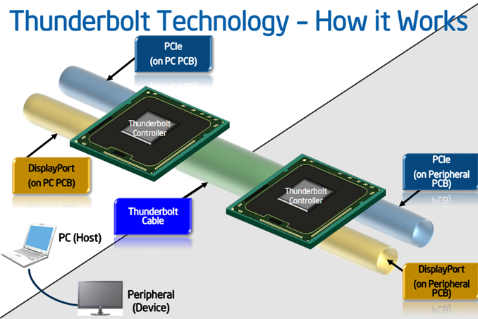

# Todo: mac Pro 2013 - Consider to understand the Thunderbolt 2 connector and protocol abilities?

```#e6803f7b``` *As of 2019-03-08 21:28*

[mail plain/text](mail.txt)


It seems to make good choices on what external storage I can connect to the Mac Pro I need to understand the Thunderbolt 2 connections and protocol?

==&gt; Also see "[Todo: Consider to understand the USB-C connector and the protocols Thunderbolt, DisplayPort, USB and PCI Express it supports transfer of?](../0eb2cde1/chime.md)"

-1) Consider to document the current "bottom line" regarding my options for external storage for my Mac Pro 2013?

==&gt; Consider to use Apple &#91;mini display port&#93; Thunderbolt 2 &lt;---&gt; Thunderbolt 3 &#91;USB-C&#93; BUT remember the shortcomings:

**1) The Device MUST be a PCIe device (No USB protocol can travel the Thunderbolt 2 in to the Mac)**

**2) The Device MUST have its own power (No power is transferred through the Apple &#91;mini display port&#93; Thunderbolt 2 &lt;---&gt; Thunderbolt 3 &#91;USB-C&#93; cable)!**

==&gt; Apples &#91;mini display port&#93; Thunderbolt 2 &lt;---&gt; Thunderbolt 3 &#91;USB-C&#93; will tunnel PCIe (NVMe) or Display Port (NOT USB as Thunderbolt 2 does NOT support tunnelling of USB)

1) consider good resources on the Thunderbolt 2 connector and protocol abilities?

==&gt; Consider Anandtech article "Intel's Thunderbolt 2: Everything You Need to Know" (<https://www.anandtech.com/show/7049/intel-thunderbolt-2-everything-you-need-to-know> )?

==&gt; It seems Thunderbolt 2 can accomplish 1.5 GB/s to external storage?

> "Thunderbolt storage devices top out at 800 - 900MB/s, Thunderbolt 2 should raise that to around 1500MB/s (overhead and PCIe limits will stop you from getting anywhere near the max spec)."

==&gt; Consider Anandtech article "New Thunderbolt Controllers (DSL4510/4410) and Future 20Gbps Falcon Ridge TB Controller Announced" (<https://www.anandtech.com/show/6885/new-thunderbolt-controllers-dsl45104410-and-future-20gbps-falcon-ridge-tb-controller-announced> )?

==&gt; It seems Thunderbolt 2 really only tunnels PCIe and Display Port links?



<https://images.anandtech.com/doci/6885/ThunderboltLayout_678x452.png>

==&gt; Consider wikipedia on the Thunderbolt Protocol (<https://en.wikipedia.org/wiki/Thunderbolt_(interface)> )?

==&gt; It seems Thunderbolt 2 tunnels up to 4 lanes of PCIe 2.0?

> "  
> Protocol
> - Thunderbolt v1: [4× PCI Express 2.0](https://en.wikipedia.org/wiki/PCI_Express#PCI_Express_2.0),[&#91;3&#93;](<https://en.wikipedia.org/wiki/Thunderbolt_(interface)#cite_note-programmingguide-3>)[DisplayPort 1.1a](https://en.wikipedia.org/wiki/DisplayPort#1.0_to_1.1)[&#91;2&#93;](<https://en.wikipedia.org/wiki/Thunderbolt_(interface)#cite_note-intelbrief2012-2>)
> - Thunderbolt v2: 4× PCI Express 2.0, [DisplayPort 1.2](https://en.wikipedia.org/wiki/DisplayPort#1.2)
> - Thunderbolt v3: [4× PCI Express 3.0](https://en.wikipedia.org/wiki/PCI_Express#PCI_Express_3.0), DisplayPort 1.2 (2 streams)[&#91;4&#93;](<https://en.wikipedia.org/wiki/Thunderbolt_(interface)#cite_note-4>), [USB 3.1 gen. 2](https://en.wikipedia.org/wiki/USB_3.1)
  
> "

==&gt; Thus, It seems we can conclude that there is no way to connect and USB 3.2 device to a thunderbolt 2 connection?

==&gt; Consider Intels Thunderbolt controller chips (<https://ark.intel.com/content/www/us/en/ark/products/series/79641/thunderbolt-products.html> )?

==&gt; It seems the DSL5320 and DSL5520 are Intels thunderbolt 2 controllers?

> [Intel® DSL5320 Thunderbolt™ 2 Controller](https://ark.intel.com/content/www/us/en/ark/products/76719/intel-dsl5320-thunderbolt-2-controller.html)Launched2Single  
> [Intel® DSL5520 Thunderbolt™ 2 Controller](https://ark.intel.com/content/www/us/en/ark/products/76721/intel-dsl5520-thunderbolt-2-controller.html)Launched4Dual

2) Consider what options I can imagine to connect external storage to my Mac pro 2013?

==&gt; Consider my external storage "needs"

==&gt; Consider I would like a fast "scratch" drive at peak Thunderbolt 2 transfer speed of 1.5 GB / s?

==&gt; Consider I would like a fast "Virtual Computer" drive for my Windows 10 (and possibly a number of Linux machines) at peak thunderbolt 2 speeds of 1.5 GB / s?

==&gt; Consider I also would like a number of external HDDs for backup

==&gt; At the "Mac" end I have 6 x USB 3.0 (5 Gb/s) and 4 x Thunderbolt 2 (20 Gb/s)

==&gt; An external HDD "tops out" at around 150 MB/s (or 250 MB/s in "twin" RAID) so for then USB-3 is enough?

==&gt; Available external SSDs top out at around 450 MB/s so in theory an USB-3 is good enough for them to?

==&gt; An External PCIe NVMe SSD could in theory reach 1.5 GB / s - so I would need to find a way to connect such a drive to Thunderbolt 2 (4 x PCIe gen 2.0)

==&gt; I could try to find a Thunderbolt 2 PCIe NVMe 1.5 GB/s SSD - \*Where?\* and \*Price?\*

==&gt; I could try to find Thunderbolt 3 external storage and use Apples adapter "Thunderbolt 3 to Thunderbolt 2" (<https://www.apple.com/shop/product/MMEL2AM/A/thunderbolt-3-usb-c-to-thunderbolt-2-adapter> )?

3) Consider to find Thunderbolt 2 1.5 GB external SSDs?

TODO: Try to find Thunderbolt 2 external storage with 1.5 GB / s transfer speed?

4) Consider to find Thunderbolt 3 1.5 GB external SSDs?

==&gt; Consider to use Apples "Thunderbolt 3 (USB-C) to Thunderbolt 2 Adapter" (<https://www.apple.com/shop/product/MMEL2AM/A/thunderbolt-3-usb-c-to-thunderbolt-2-adapter> )?

TODO: Try to find Thunderbolt 3 external storage with 1.5 GB / s transfer speed?

5) Consider to find good and reliable USB-3 HDD external storage?

==&gt; Consider LaCie "Rugged" series of portable HDDs?

6) Consider the OWC external storage options for Mac Pro 2013?

==&gt; Consider the OWC drive dock (<https://eshop.macsales.com/shop/external-drives/owc-drive-dock> )?


7) Consider what adapters I can imagine to use to get god connection between external storage and my Mac Pro 2013?

==&gt; Consider if there are any adapters to connect USB 3.2 devices to appear as Thunderbolt 2 devices (remember that Thunderbolt 2 does NOT tunnel USB)?

...

...


