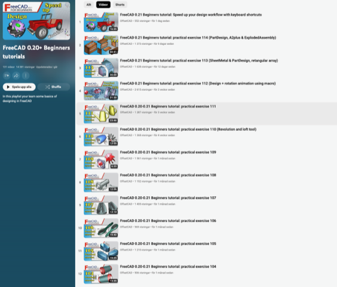

# Todo: Consider to learn FreeCad by following youtube channel "OffsetCAD" exercises on FreeCad 0.21?

```#e6d6f21a``` *As of 2023-11-23 08:59*

[mail plain/text](mail.txt)


I want to be able to use a CAD tool to design things to build and I think FreeCad can be that tool if I can learn to use it with ease.

1) Consider FreeCad exercises published by Youtuber "OffsetCAD" (<https://www.youtube.com/@OffsetCAD> )?



<https://www.youtube.com/playlist?list=PLVWDQhBHqKgHhB-cH3V2f2578h36BO0tp>

...


