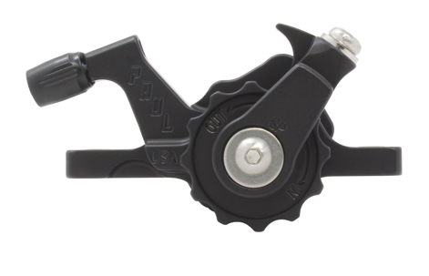
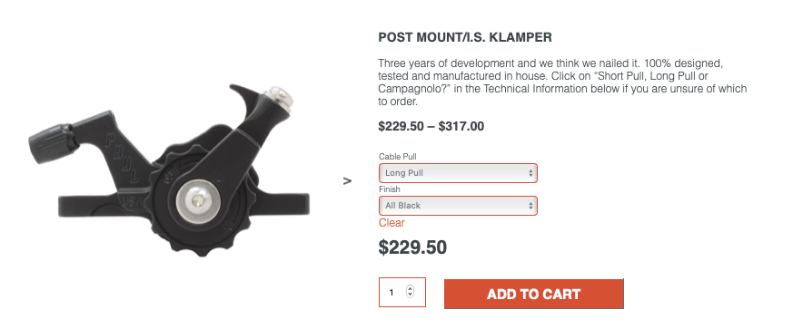
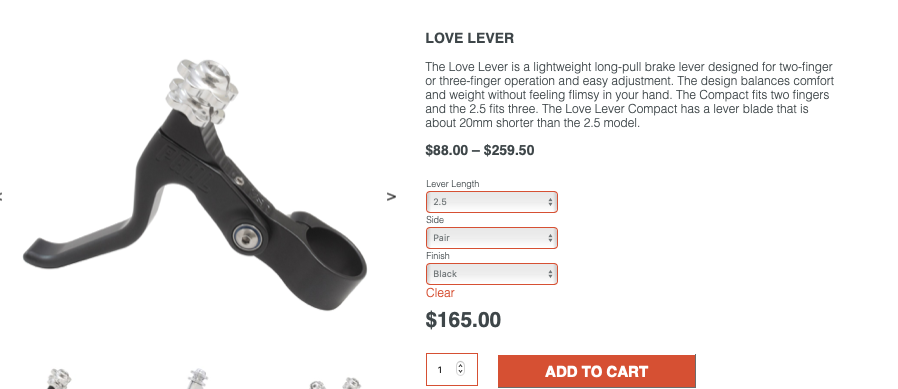
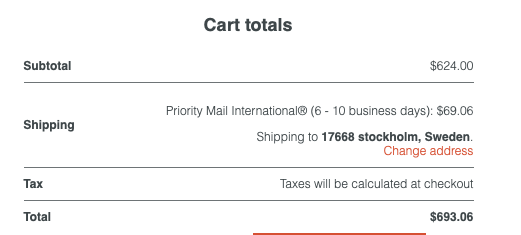

# Todo: Consider to go for Pauls  POST MOUNT/I.S. KLAMPER for low maintenance and long life mechanical disc brake setup?

```#e7534bf1``` *As of 2021-08-18 23:59*

[mail plain/text](mail.txt)


1) Consider Pauls POST MOUNT/I.S. KLAMPER (<https://www.paulcomp.com/shop/components/brakes/disc-brakes/i-s-klamper/> )?

>   
> 

==&gt; I need two of these which will mean 422 g of weight and $460 + shipping.

2) Consider the Love Levers (<https://www.paulcomp.com/shop/components/brake-levers/long-pull/love-lever/> )?

> It seems theese goes well with the Long Pull variant of Pauls klamper?

> *"These levers are compatible with all long-pull cable operated brakes. We recommend them for use with our Motolite brakes, but they will work well paired with any v-brake, long-pull mechanical disc brake, (like our Klamper), or any other long pull brake. For a short pull brake lever see our Canti Lever."*

> 

==&gt; It seems a pair adds 274g and sets me back $165 + shipping?

3) It seems two klamps and a pair of Love levers including shipping will add 700g to my bike and cost me $700 and will take close to 10 weeks to be manufactured?

> 

...


