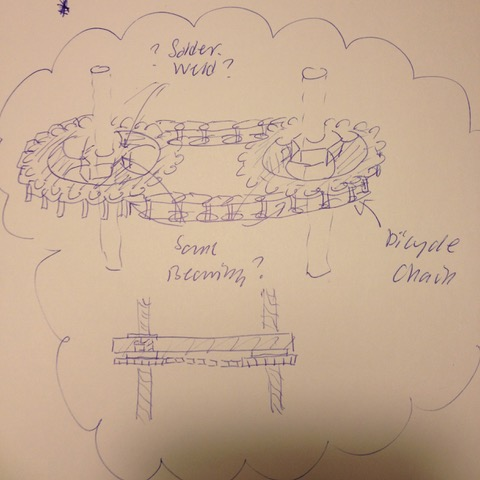

# Todo: Consider to create linear motion using threaded rods and a bicycle chain driven hex-nuts (e.g., for a router lift or super strong rip fence adjustment)?

```#e7c7fec9``` *As of 2022-07-31 17:30*

[mail plain/text](mail.txt)


It seems we should be able to build simple, cheap and still strong and exact linear drives using threaded rods with bicycle chain driven bolts (travelling the threaded rods)?

1) Consider to be inspire by this design of a chain driven UJK router elevator (<https://swedendro-tools.se/se/produkter/frasa/stationara-maskiner/ujk-frasbord/ujk-fraslyft> )?


2) Consider to find a chain and pinions to drive ordinary text nuts along the threaded rod?

==&gt; Consider bicycle chains are actually very cheap (<https://www.cykelkraft.se/kedja-cykel-0-8-vaxlat-shimano-nexus-antikorrisions-behandlad?gclid=Cj0KCQjw_7HdBRDPARIsAN_ltcK62lyQZ_Ckv15L7WFw5Ps1O01Nf7hKDRC1bpMRBMd0aBD9wzjlQpYaAtfrEALw_wcB>)?


==&gt; Consider bicycle chain pinions are actually not so expensive (<https://www.cykelkraft.se/sram-sprocket-16t-straight-for-i-motion-3-t3-p5-s7>)?


Note: What do I miss (It can’t be that cheap to buy a bicycle pinion)?

==&gt; This chain seems to be recommended to fit the SRAM pinion (<https://www.cykelkraft.se/kedja-cykel-0-8-vaxlat-standard-med-fotbroms>)?


3) Consider bicycle ball and roller bearings (<https://www.cykelkraft.se/cykeldelar/kullager>)?


==&gt; Consider this very cheap but perhaps usable ball ring (<https://www.cykelkraft.se/kulring-shimano-bromssidan-0-vaxlad>)?


4) Consider we actually need to weld (or solder) the hex nut to the bicycle pinion somehow?

TODO: Consider to delve deeper into how to assemble the hex nut with the bicycle pinion and allow rotation round some bearing?



...


