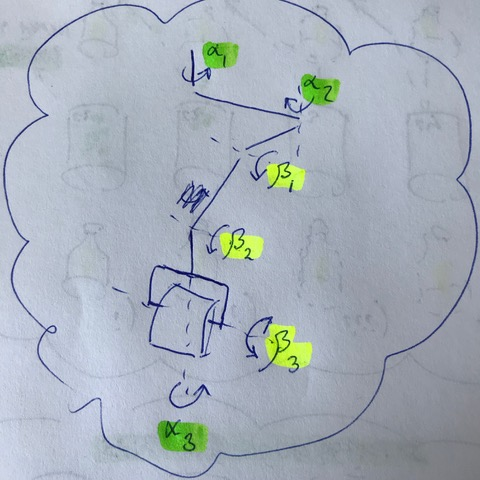
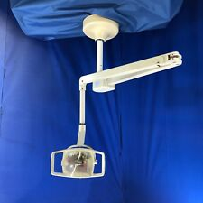
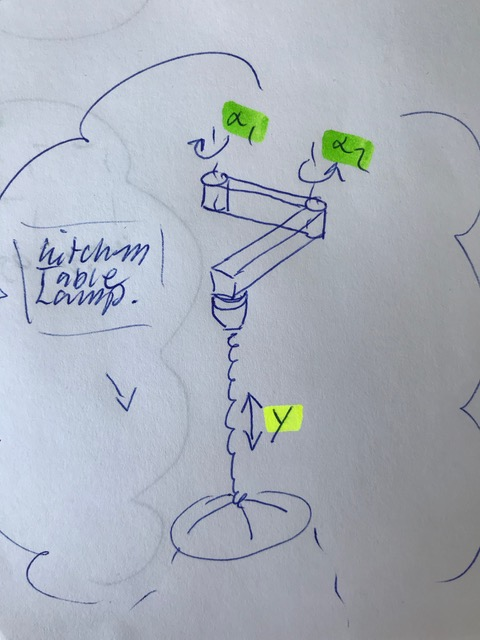
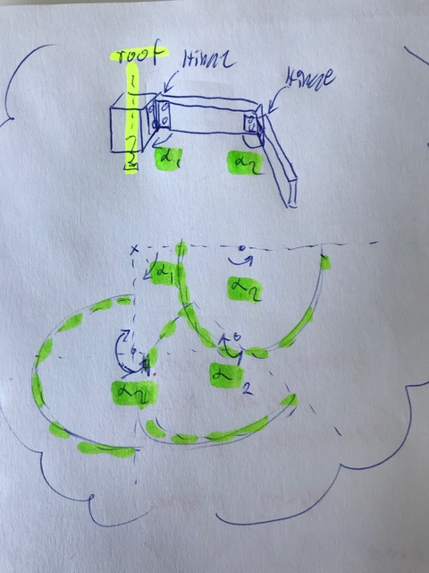

# Todo: Consider to leverage the Dental Ceiling Light arm mechanical design for home decoration (like a movable kitchen table lamp) and movable indoor shed tool tray?

```#e84e4e90``` *As of 2019-05-14 11:29*

[mail plain/text](mail.txt)


It seems the mechanical design of the arm of a dental ceiling light is interesting and can be re-used for purposes like movable kitchen lamp and indoor shed movable tool tray solutions?

1) Consider how the Dental Ceiling Lamp arm is designed?

==&gt; Consider youtube video "Dental ceiling light for my lab" (<https://www.youtube.com/watch?v=0wNrZmE34cg> )?

==&gt; It seems to move in three vertical and three vertical rotation axes with fixed axel lengths?



Dental Ceiling Light arm moves in Three vertical rotations (alpha 1...3) and three horizontal rotation (Beta 1...3) with fixed axes lengths?


==&gt; It seems it begins with a 360 degree freedom rotate-able vertical axes mounted to the roof?



<https://www.ebay.com/itm/Healthco-Ceiling-Mount-Dental-Light-/132884178783>


[*https://www.ebay.com/itm/Dental-Oral-Light-Lamp-Operating-Lamp-6-LED-Lens-Ceiling-mounted-Type-With-Arm-/183695883825](https://www.ebay.com/itm/Dental-Oral-Light-Lamp-Operating-Lamp-6-LED-Lens-Ceiling-mounted-Type-With-Arm-/183695883825) *

2) Consider a kitchen table lamp only requires two vertical rotation axes (the height adjustment comes with the lamp)?



==&gt; Consider a mechanical design of a two vertical axes kitchen table lamp hanger made out of wood?

Q: How can we make the hanger sturdy enough?

Q: Can we imagine 3" x 1" (2,25 x 7,5 cm) fir construction timber to be sturdy enough?



...


