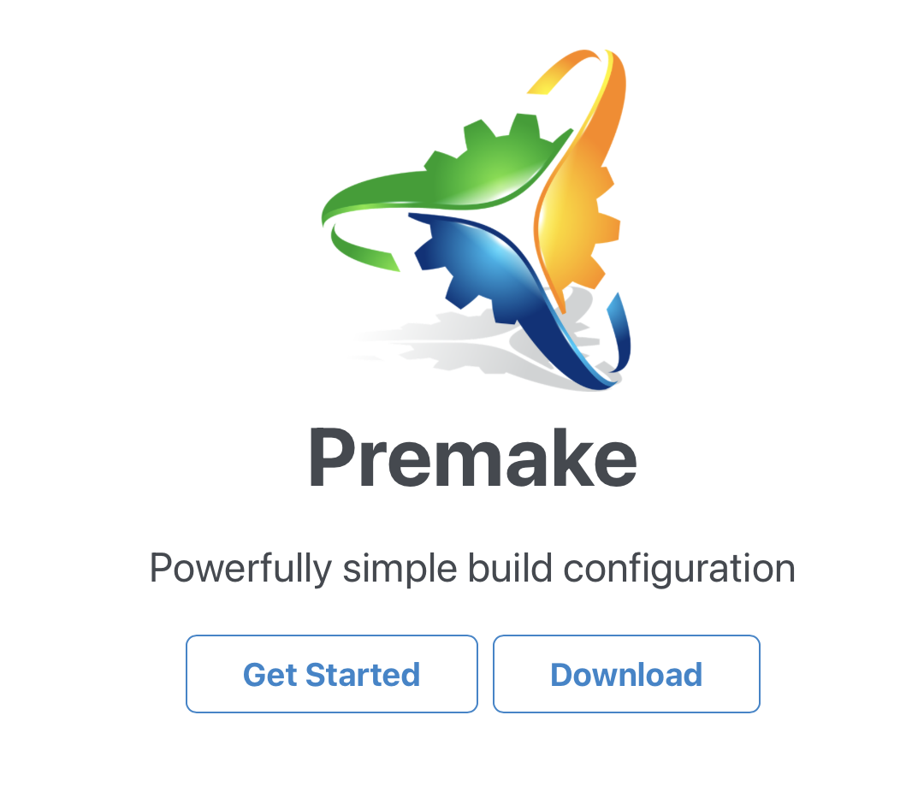

# Todo: Consider to use Premake instead of CMake for cross platform C++ applications builds?

```#e8ea6b0b``` *As of 2025-01-19 22:09*

[mail plain/text](mail.txt)


I want ot up my game with Cratchint and Premake as a lua based build system builder attracts me.

1) Consider youtube video "How to Properly Setup C++ Projects" (<https://youtu.be/5glH8dGoeCA> )?

2) Consider the template Github project "C++ Project Starter Template" to create my own Premake based C++ app builder builder (<https://github.com/TheCherno/ProjectTemplate> )?

3) Premake seems to live here on Github (<https://github.com/premake/premake-core> )?

> "Welcome to Premake

> Premake is a command line utility which reads a scripted definition of a software project, then uses it to perform build configuration tasks or generate project files for toolsets like Visual Studio, Xcode, and GNU Make. Premake's scripts are little Lua programs, so the sky's the limit!"

4) This seems to be the Premake "hole site" (<https://premake.github.io> )?



...


