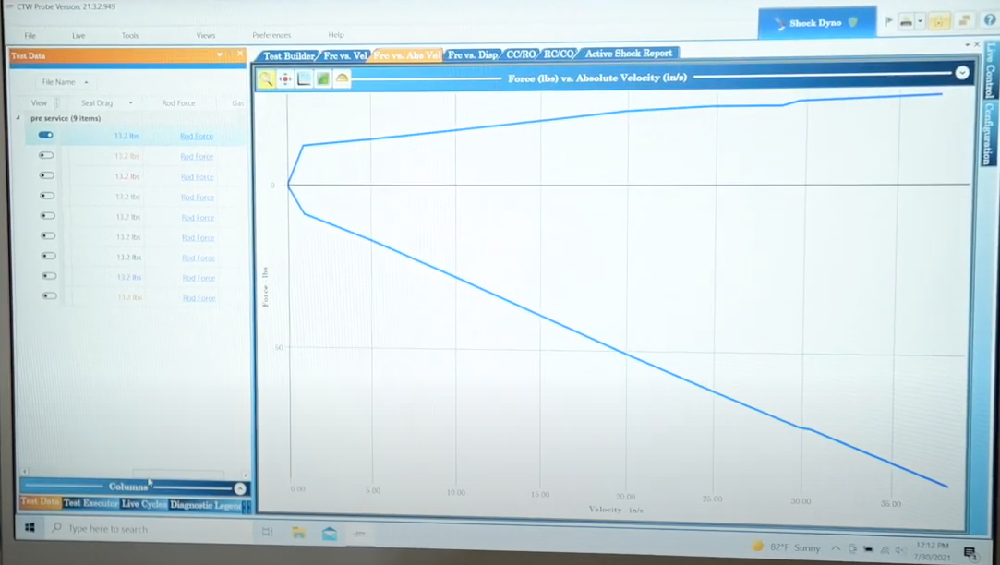

# Todo: Consider the "seal drag" off a Fox 36 bicycle front suspension fork is between 60N (unserviced) and 50N (Serviced)?

```#e9c55f70``` *As of 2021-08-30 01:41*

[mail plain/text](mail.txt)


I want a first-principle "good" front fork suspension for my bicycle and find the friction of air forks are simply to large for my taste (am I wrong)?

==&gt; Also see "Todo: Consider that my "dream" bicycle suspension fork is an upside down coil fork?"

1) Consider this youtube video "Fork seal drag and why you should service your MTB suspension" where they state the seal "drag" to be 13 pounds unserviced (<https://youtu.be/7t3EpdZgpNQ> )?

> 

> Now the graph does not readily make sense to me (Force vs Velocity)?

> 

> *I mean "true" friction is not velocity dependant but here some "force" is. Could it be that they are measuring the fork with the damper engaged? I suppose that is it :)*

> *Anyhow, in the video, and in the report shown on the filmed display, they state the "fork seal drag" is 13,2 pounds?*

> *Some googling gives me that the lbs "pounds" they are talking about is the weight pound as in 1 lbs is 0,454 kg?*

> *This means they suggest the "seal drag" is 13,2 \* 0,454 kg \* 9,81 N/Kg = 60N.*

> *And after the service they claim a 14% reduction which should mean around 0,86 \* 60N = 50N.*

> *I think that is still a LOT?!*

> *At least if you want the fork to react to small high frequency bumps in the road?*

> Basically this means the fork will NOT MOVE until hit with a force greater than 5 to 6 kg of "weight".

> I suppose, in practice though, the weight of the bike and rider will override that force and reduce the vibrations they cause with the ration between the 50N "sticking force" and the 40% vehicle plus rider weight which is say 350N.

> Still, we still get 50/350 = 14% of the vibrations traveling up to the bike frame of my hard tail?

> Hm... I may have to investigate this further to understand what I am actually talking about here?

2) Consider this article "COIL FORK VS AIR FORK: PROS AND CONS" that seems to confirm my suspicion that coil forks are actually lower maintenance and hight suspension performance although heavier and less adjustable (<https://wheretheroadforks.com/coil-fork-vs-air-fork-pros-and-cons/> )?

...


