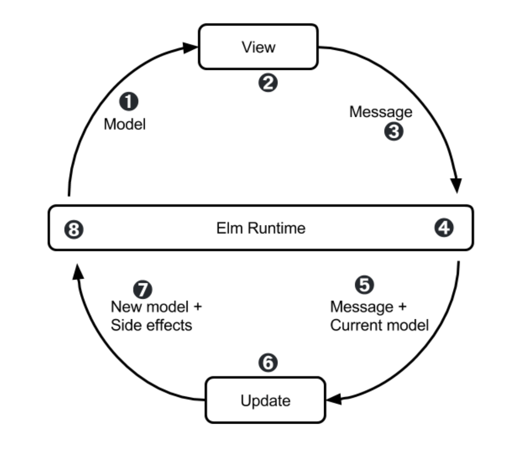

# Todo: Consider the Elm architecture as described by 'Elm workshop' and possibly how to implement it in C++ and cratchit?

```#e9c6a9d6``` *As of 2025-02-20 11:50*

[mail plain/text](mail.txt)


I still want to implement a C++ Elm architecture in craychit and possibly other C++ programs.

==&gt; Also see "[Todo: Consider The Elm Architecture (TEA) based Github project "TeaGameLibrary"?](../aaf4c309/chime.md)"

1) Consider the 'Elm Workshop' walk through of the Elm architecture (<https://sporto.github.io/elm-workshop/03-tea/01-intro.html> )?



2) Consider C++ implementations on Github of TEA, The Elm Architecture?

==&gt; Consider the Github Project "TeaGameLibrary" (https://github.com/elipmoc/TeaGameLibrary/tree/master )?

==&gt; See "[Todo: Consider The Elm Architecture (TEA) based Github project "TeaGameLibrary"?](../aaf4c309/chime.md)"

...


