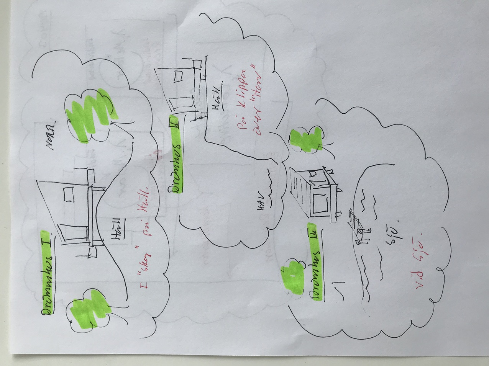

# Todo: Eget Hus - Överväg tre "Drömhus" (På häll i skog, på klippa över "hav" och Vid sjö)?

```#ea75d78f``` *As of 2019-04-03 13:05*

[mail plain/text](mail.txt)


Det verkar som om jag har tre drömhus i min föreställningsvärld?

1) Överväg att konkretisera de tre drömhusen jag har i mitt huvud?



2) Överväg att planera för “Ett hus på häll i skogen”?

==&gt; Hur kan jag bygga ett hus på en häll i skogen om jag inte har någon väg fram till huset?

==&gt; Kan jag konstruera en en-spårs järnväg genom skogen på vilken jag kan transportera människor och material till huset?

Q: Kan jag köpa begagnade järnvägsspår att använda för spårväg till huset (och som pelare under huset)?

…

3) Överväg att planera för “Ett hus på klippa över havet”?

==&gt; Kan jag hitta en tomt på en klippa över havet med bilväg fram till huset?

==&gt; Kan jag bygga på en ö i skärgården på “en klippa över havet”?

…

4) Överväg att planera för “Ett hus vid en sjö”?

==&gt; Kan jag bygga ett hus vid en sjö med sjötransport till huset?

==&gt; I så fall räcker det med att det finns väg till sjön (så kan jag sedan ta båt till huset)?

==&gt; Planera hur jag kan bygga ett hus vid en sjö med bara sjötransport till huset?

==&gt; Överväg att bygga ett hus i skärgården på detta sätt (endast sjötransport till huset)?

...

5) Överväg att köpa begagnade maskiner från Baupool (<https://www.baupool.com/sv/gebraucht/a-Gleisbau/69/> )?

==&gt; Baupool verkar sälja begagnade containrar för pris-på-förfrågan (<https://www.baupool.com/sv/details/Materialcontainer/Gebrauchte-Lagercontainer-und-Seecontainer/4501466/> )?

==&gt; Det verkar som om begagnade minikranar från Baupool ligger kring en halv miljon (<https://www.baupool.com/sv/gebraucht/a-Krane/45/b-Minikrane/866/netgross/1/pastdays/99999/sort/DESC/sortby/date/> )?

Q: Hur kan jag konstruera en kran som jag också kan transportera och använda på en tomt utan väg fram till tomten?

...


