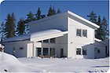
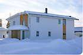
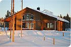
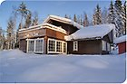
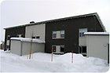
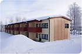

# Todo: House Build - Consider the Umeå municipal initiative "Energieffektivt byggande i kallt klimat"

```#ea9f5d75``` *As of 2019-10-08 21:49*

[mail plain/text](mail.txt)


I need more information about support from municipals, the Swedish state and research on building houses with close to zero environmental footprint?

==&gt; Also see "Todo: Own house build - Consider to study the house "Villa Falk" in "MåBraByn" in Robertsfors municipality?"

1) Consider The Umeå Municipal article on "Energieffektivt byggande i kallt klimat" (<https://www.umea.se/umeakommun/byggaboochmiljo/energiochuppvarmning/projektochnatverk/energieffektivtbyggandeikalltklimat.4.1c82affc124ecb0bbe580007824.html> )?

==&gt; Consider to delve into the six different projects listed by Umeå Municipal administration with the frame of project "Energieffektivt byggande i kallt klimat"?

> Läs mer om de olika byggprojekten  
>   
> Villa Carlstedts (<https://www.umea.se/umeakommun/byggaboochmiljo/energiochuppvarmning/projektochnatverk/energieffektivtbyggandeikalltklimat/villacarlstedts.4.774fe05812efd4e09598000453.html> )  
>   
> Villa Dario (<https://www.umea.se/umeakommun/byggaboochmiljo/energiochuppvarmning/projektochnatverk/energieffektivtbyggandeikalltklimat/villadario.4.774fe05812efd4e09598000753.html> )  
>   
> Villa Falk (<https://www.umea.se/umeakommun/byggaboochmiljo/energiochuppvarmning/projektochnatverk/energieffektivtbyggandeikalltklimat/villafalk.4.774fe05812efd4e09598000821.html> )  
>   
> Villa Pettersson (<https://www.umea.se/umeakommun/byggaboochmiljo/energiochuppvarmning/projektochnatverk/energieffektivtbyggandeikalltklimat/villapettersson.4.774fe05812efd4e09598000921.html> )  
>   
> Kvarteret Gröngård (<https://www.umea.se/umeakommun/byggaboochmiljo/energiochuppvarmning/projektochnatverk/energieffektivtbyggandeikalltklimat/kvarteretgrongard.4.7053ae821362a1b437c32b1.html> )  
>   
> Kvarteret Kullen (<https://www.umea.se/umeakommun/byggaboochmiljo/energiochuppvarmning/projektochnatverk/energieffektivtbyggandeikalltklimat/kvarteretkullen.4.7053ae821362a1b437c32a5.html> )

...


