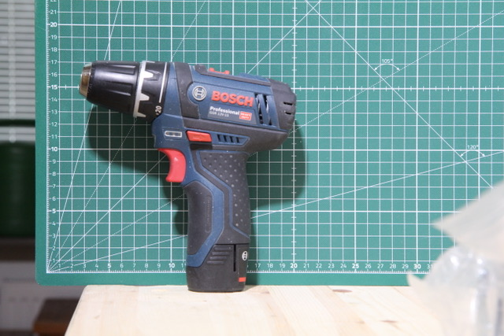
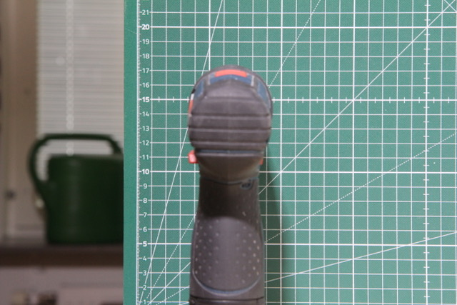
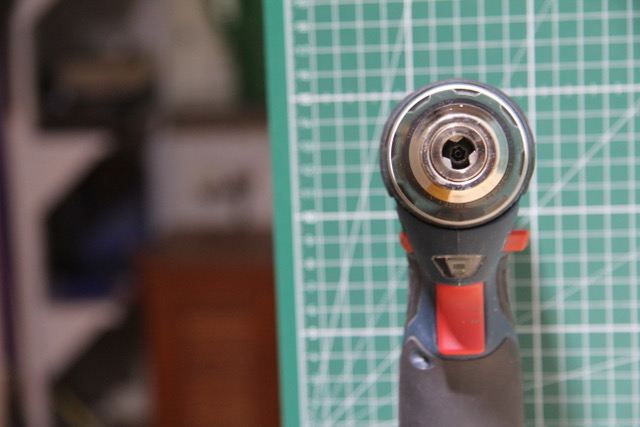

# Todo: Consider to 3D print an adapter for my Bosch GSV12V-15 drill driver to fit into a Euronorm 43 mm collar mount?

```#eaa05d5a``` *As of 2021-07-28 15:09*

[mail plain/text](mail.txt)


I would like to be able to mount my cordless drill driver into Euronorm 43 mm collar mounts.

> *The basic idea is to find out if it would be possible to design an adapter that fits my Bosch GSV12V-15 drill driver and enables me to mount it into the "standard" Euronorm 43 mm collar mounts?*

> *Problem 1: The existing collar measures 48,5 mm.*

> *Now the chuck goes from 43,2 mm down to 35 mm over a 34 mm length. So it may be possible to design the adapter to have a 43 mm collar somewhere towards the mouth of the chuck and still be able to get a grip of the chuck to fasten it?*

*1) Consider to model the adapter in Fusion 360 based on photographs of the drill driver?*

> 

*... *


