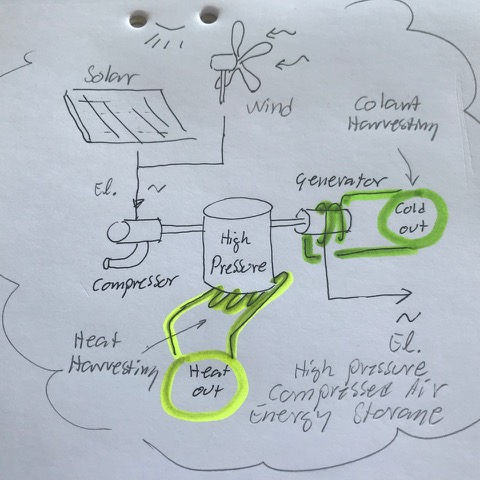
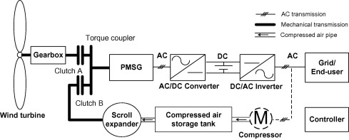

# Todo: Consider a high pressure compressed air energy storage (CAES) driven by wind and solar panels for my house electricity, heating and refrigeration requirements?

```#eadb6821``` *As of 2019-11-15 13:26*

[mail plain/text](mail.txt)


It seems I can build a high pressure compressed air energy storage for my house and get electricity from an air turbine and the heat from compressions and cooling from decompression as bi products?

1) Consider this article "Ditch the Batteries: Off-Grid Compressed Air Energy Storage" (<https://www.lowtechmagazine.com/2018/05/ditch-the-batteries-off-the-grid-compressed-air-energy-storage.html> )?

==&gt; It seems for residential use we can take advantage of the high pressure compressed energy storage losses in heat and harvest the heating and cooling for household heating and food refrigeration?

> *"**Small-scale, high pressure systems use the dissipated heat of compression for residential heating and hot water production, while the cold expanding air is used for space cooling and refrigeration.**"*

> *"While large-scale AA-CAES aims to recover the heat of compression with the aim of maximizing electricity production, these small-scale systems take advantage of the temperature differences to allow trigeneration of electrical, heating and cooling power."*

==&gt; It seems electric-to-electric, as when driven by solar panels or wind turbine generators is only at best 40-50% (large scale low pressure)?

> *"Unfortunately, large-scale CAES plants are very energy inefficient. Compressing and decompressing air introduces energy losses, resulting in an electric-to-electric efficiency of only 40-52%, compared to 70-85% for pumped hydropower plants, and 70-90% for chemical batteries."*

==&gt; It seems a high pressure compressed air energy storage is only 11-17% electric-to-electric efficient?

> *"Small-scale CAES systems with high pressures give the opposite results. For example, a configuration modelled for a typical household electrical use in Europe (6,400 kWh per year) operates at a pressure of 200 bar (almost 4 times higher than the pressure in large-scale CAES plants) and achieves a storage volume of only 0.55 m3, which is comparable to batteries. However, the electric-to-electric efficiency of this set-up is only 11-17%, depending on the size of the solar PV system. &#91;9&#93;"*

==&gt; Consider though that my zero-energy-house with efficient heat exchangers and low need for refrigeration cooling due to Sweden cold climate?

> *I am actually not sure to what degree I can take advantage of the heat and cold I can harvest from the high pressure compressed air storage system? I mean, I can build my house with good insulation and have very low heating requirements. I can get down to zero heating needs by making the house sufficiently warm using only passive warming from bode and home appliance heat dissipation. And depending on the efficiency of the heat exchangers to re-use heat from waste water and air ventilation I may have quite low energy cost to heat water too?*

> *But I suppose it is not zero either. And I have to cook food which requires either electric heating or heating from stored heat so maybe there is a tradeoff where I can use the heat produced by losses in the high pressure CAES for good use and reduce my need from electric heating of water. And end up with a system that beats or at least compares to an electric battery storage system when it comes to energy storage efficiency, life expectancy and maintenance cost taken in as a whole?*

2) Consider wikipedia on Compressed Air energy storage (<https://en.wikipedia.org/wiki/Compressed_air_energy_storage> )?

==&gt; It seems theoretically we can store around 500 kWh in 1 cubic meter of air into a 5l compressed air tank?

> *"Thus if 1.0 m3 of air from the atmosphere is very slowly compressed into a 5 L bottle at 20 MPa (200 bar), the potential energy stored is 530 kJ. A highly efficient air motor can transfer this into kinetic energy if it runs very slowly and manages to expand the air from its initial 20 MPa pressure down to 100 kPa (bottle completely "empty" at atmospheric pressure)."*

==&gt; It seems to reduce energy losses in the form of friction (heat) we need to compress and decompress the air "very slowly" and get out 300 kWh from 530 kWh stored?

> *"Achieving high efficiency is a technical challenge both due to heat loss to the ambient and to unrecoverable internal gas heat.&#91;37&#93; If the bottle above is emptied to 1 MPa, the extractable energy is about 300 kJ at the motor shaft."*

==&gt; Consider in a practical system we would like the system to operate in a much narrower span of pressure (to have compressor and generator operate in some efficient pressure and speed range)?

> *My intuition tells me that we would like the system to operate at some restricted range of pressure to be able to store and extract energy sufficiently efficient at some reasonable speed? I mean, at a very low pressure we would not be able to extract very much wattage, do we? And storing energy into a tank with low pressure would require a hight air flow into the tank with hight heat losses. So in a way we would like the system to operate in some pressure interval where the air flow rate is in some efficient range not to loose too much energy as heat?*

3) Consider my imagined concept of solar and wind electricity driven high pressure compressed air energy storage with both dissipated heat and cold harvesting plus electricity production?



*High pressure compressed air energy storage where dissipated heat and cold is also harvested for household heating and food refrigeration*

4) Consider the inconvenient fact that high pressure storage produces heat in the summer and cold in the winter (harvesting vs consumption) which is the opposite of what I "need"!

> *It is inconvenient that when I harvest energy in the summer the air compression produces excess heat. But in the summer I do not need heat! Also, the high pressure air storage produces cold during decompression to consume stored energy which is also not something I need in the winter! It is like nature has rigged the system to be optimised to make efficient use of energy hard!*

5) Consider this study "Feasibility study of a hybrid wind turbine system – Integration with compressed air energy storage" (<https://www.sciencedirect.com/science/article/pii/S0306261914006680> )?



==&gt; Consider how they seem to use the compressed air storage tank as a "energy mass" to drive the wind turbine generator to smooth out the irregularities of the wind energy input?

==&gt; Consider the figure does not show if and how they harvest heat energy from air compression or cooling abilities from the decompressed air heat consumption?

5) Consider if there are any products to buy to get a high pressure compressed air energy storage with heat and cold harvesting capabilities?

TODO:

...


