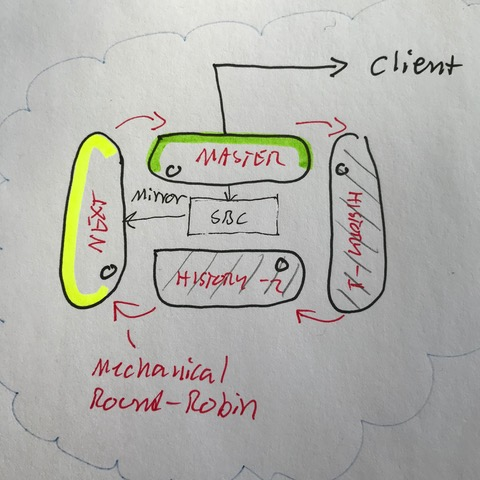
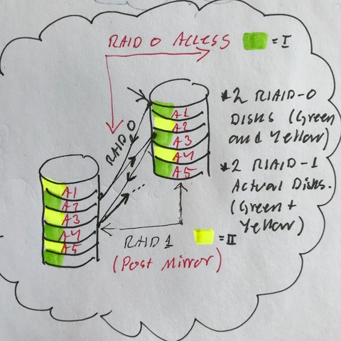
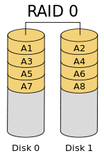

# Todo: Consider a motorised external storage cabinet for portable drives that circulates a master and one or more backups in a mechanical round-robin configuration?

```#eb39d80c``` *As of 2019-03-10 11:28*

[mail plain/text](mail.txt)


It just seems like a fun idea to have an external storage cabinet that can host two or more portable drives in a mechanical round robin mechanism in effect creating a physical backup storage with history?

1) Consider the algorithm implemented by the mechanical round-robin mechanism?

==&gt; Consider we would like to implement a backup history with one master drive and then one or more backup history drives?

==&gt; Consider at any time the current master drive is mirrored to the next-free drive using e.g., RAID or some other standard mirroring method?

==&gt; Consider the mechanical round robin should connect only the current master drive to the computer (storing history backup drives in unconnected state)

==&gt; Consider to have the next-in-line (the one-past-last-history drive) connected to the master drive for mirroring by the cabinet?



*Four disk mechanical round-robin external drive backup cabinet*

==&gt; Consider we would like an internal mirror mechanism like RAID 1 but an external acces (write and read) like RAID 0?

==&gt; Consider client Read and Write would access the disks as RAID 0 disks (data striped interleaved on two disks)?

==&gt; Consider we would like internal mirroring to be RAID 1 (full redundancy with complete mirroring)?



*RAID 0 read and write with background (post) RAID 1 full mirroring*

2) Consider a mechanical design of the physical portable drive round-robin mechanism?

==&gt; Consider we like the round-robin to be able to rotate four drives (moving one drive into the connected master drive position and one drive into the mirrored "Next-in-line" position)?

==&gt; Consider a mechanical connect mechanism that can operate the physical connection (USB-A or USB-C) male connector in and out of a fixed female connector?

...

3) Consider good resources on RAID?

==&gt; Consider Wikipedia article on standard RAID levels (<https://en.wikipedia.org/wiki/Standard_RAID_levels#RAID_0> )?



<https://en.wikipedia.org/wiki/File:RAID_0.svg>


<https://upload.wikimedia.org/wikipedia/commons/thumb/b/b7/RAID_1.svg/150px-RAID_1.svg.png>

==&gt; Consider wikipedia article on RAID (<https://en.wikipedia.org/wiki/RAID> )

> "RAID (Redundant Array of Independent Disks, originally Redundant Array of Inexpensive Disks) is a data storage virtualization technology that combines multiple physical disk drive components into one or more logical units for the purposes of data redundancy, performance improvement, or both. "

4) Consider the wikipedia article on nested RAID Levels (<https://en.wikipedia.org/wiki/Nested_RAID_levels#RAID_10> )?

==&gt; It seems there are NO nested RAID levels where we can use two mirrored drives and also get enhanced write speeds by write disk interleave + post mirroring?

...


