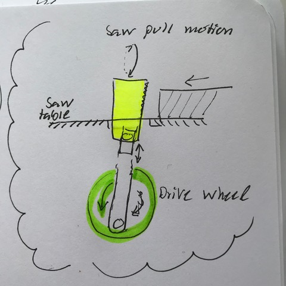
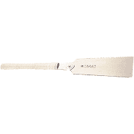

# Todo: Consider a motorised hand held saw like a European push saw or a Japanese nokogiri pull saw (e.g. the double blade Ryoba saw)?

```#eb9bd655``` *As of 2019-06-04 09:59*

[mail plain/text](mail.txt)


Could it be possible to motorise a hand held saw to create a silent, cheaper and possible safer sawing machines?

==&gt; Also see "[Todo: Consider a jig saw based miter saw station (with jig saw blade support that moves with the saw through the cut stroke)?](../f74d369e/chime.md) "

1) Consider a machine that performs pulling strokes of a Japanese Ryoba saw?

==&gt; Consider a "simple" wheel and piston mechanism to pull the saw in a slight oval motion?



*A motorised Japanese Ryoba saw as a table saw*



*A Japanese ryoba saw*

2) Consider we can motorise a European push saw by driving it from above through a slot in a table to create a table saw?

==&gt; Consider to compare with "old time" reciprocating saws to cut lumber?

...

...


