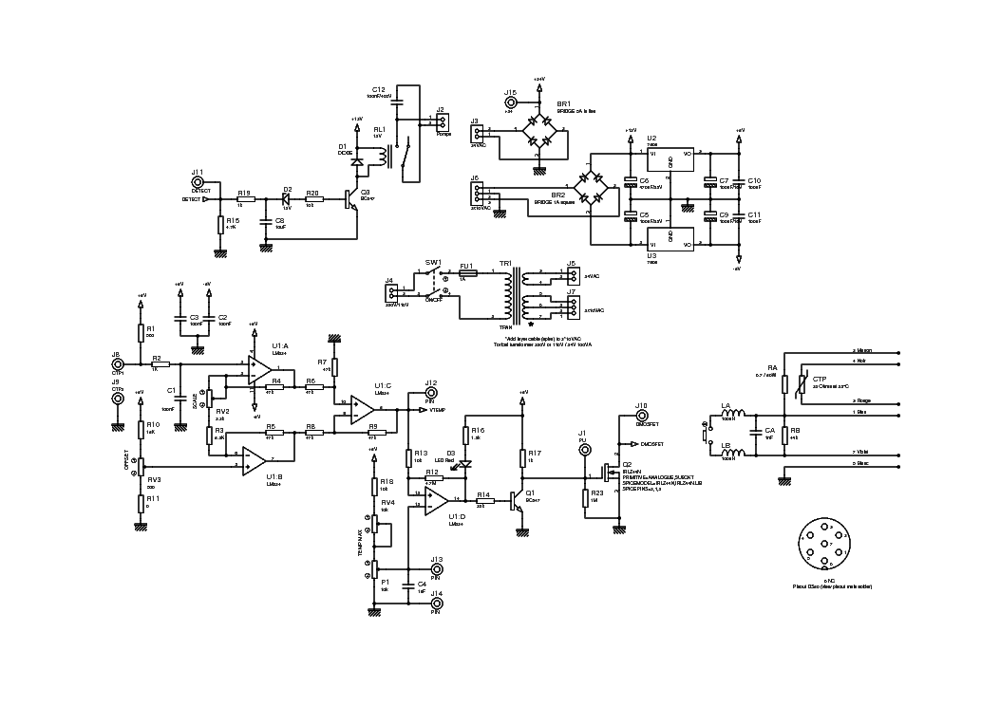
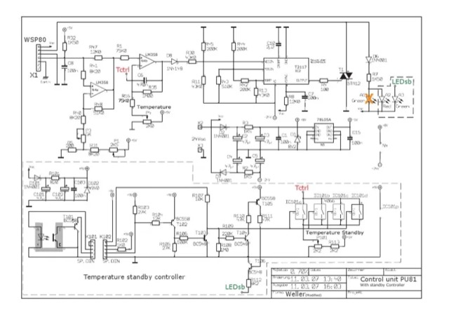
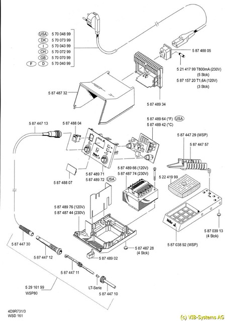

# Todo: Consider the Weller WSP 80 24V 80W soldering pen connector pin out and PU81 control unit internal schematics for Weller DSX 80 desoldering iron control?

```#ed101d6f``` *As of 2024-03-17 11:29*

[mail plain/text](mail.txt)


I own two Weller WSD 161 control units and one WSP 80 24V 80W soldering pen and wonder if I can also attach a Weller DSX 80 desoldering iron to it?

1) Consider the Weller WSP 80 pin out available on the web?

2) Consider the Weller PU 81 control unit schematics available on the web?



<https://elektrotanya.com/PREVIEWS/45612216/23432455/szerszam/forrasztoallomas/weller_s80_ds80_soldering_station_sch.pdf_1.png>



...This image copied from google search (the actual web site scribd required an account and a subscription...)

3) Consider the WSD 161 Weller explosive view from eketrotanya (<https://elektrotanya.com/weller_wsd161e_exploded_view.jpg/download.html#dl> )?



...


