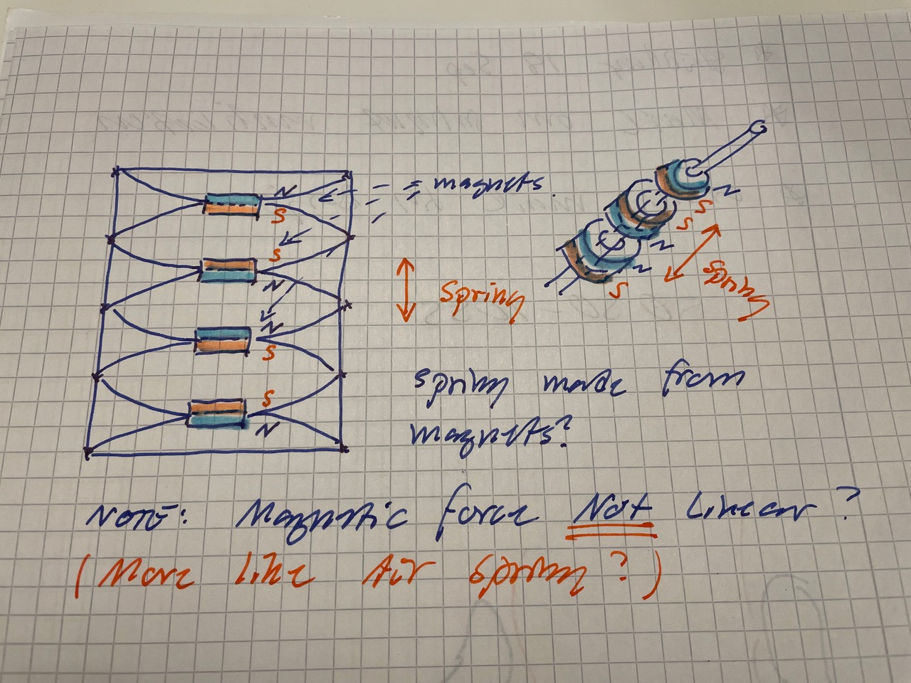
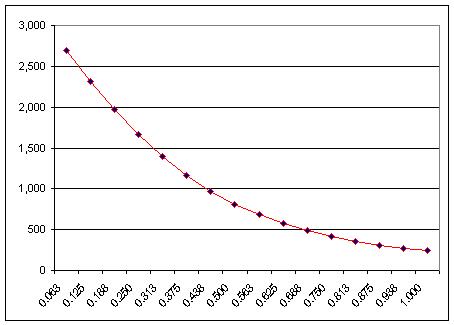
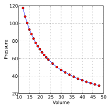
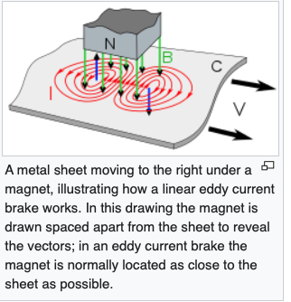
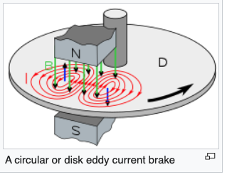

# Todo: Consider a spring based on magnetic repulsion forces (e.g., for use in a bike suspension fork)?

```#ed5574f4``` *As of 2021-08-21 01:03*

[mail plain/text](mail.txt)


> 

> *The basic idea is to investigate if we can use the magnetic repulsion or attraction force between permanent magnets to build a spring, e.g., for use in a bicycle front fork suspension?*

> *The aim would be to try and beat the weight of metal springs while still compete with the weight efficiency of an air spring?*

> *Now the magnetic force is proportional to the the inverse square of the distance between the magnets.*

> 

> Copyright <http://www.intemag.com/images/distance_graph.gif>

> *Compare this to the pressure of a gas being inversely proportional to the volume (Pressure x Volume = constant)*

> 

> Copyright <https://en.wikipedia.org/wiki/File:Boyles_Law.svg>

> *Now, for an air spring designed as a piston pressing on air inside the piston volume the volume (and thus the pressure) will be proprtional to the distance.*

> *It seems we can thus conclude that a magnetic spring will be more progressive that an air spring (The force of the magnetic spring is proportional to the inverse square of the distnace while the air spring is proportional to the inverse distance).*

*2) Consider with magnets we may accomplish also magnetic dampening by inducing eddy currents into some conductive and resistive material (or harvest the induced energy to charge a battery bank)?*

> *Consider for example if we can induce eddie currents into a standard break disc for bikes by having it rotate close to the magnetic field from a permanent magnet?*

*==&gt; Consider the wikipedia article on Eddy Current Brakes (<https://en.wikipedia.org/wiki/Eddy_current_brake> )?*

>   
> We may imagine a suspension fork damper based on eddy currents induced into the damper legs?

>   
> We may imagine a contactless bicycle disk brake based on eddy currents induced into a brake rotor?


