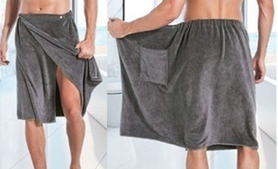

# Todo: Consider a "towel skirt" to wear on the beach to change into bathing shorts and also as a towel after the bath?

```#ee8432fc``` *As of 2020-08-30 11:39*

[mail plain/text](mail.txt)


Packing for post-exercise bath I imagined it would be practical if I had a "skirt" that was also a towel.

1) It seems the "towel skirt" already exists and is called a "bath wrap towel" (<https://www.google.com/search?client=safari&rls=en&q=towel+skirt&ie=UTF-8&oe=UTF-8> )?

>   
> *Example of a "bath wrap towel" (Copyright *[*https://contestimg.wish.com/api/webimage/5c4924109fc66c4f5b44a79c-tiny.jpg?cache_buster=6eb208559391ccb532e5fe883c71303b](https://contestimg.wish.com/api/webimage/5c4924109fc66c4f5b44a79c-tiny.jpg?cache_buster=6eb208559391ccb532e5fe883c71303b) **)*

2) Consider to make my own Towel Skirt from Terry fabric or from a modified towel?

> *The basic here is to either buy some "towel fabric" like Terry or modify an existing Terry towel into a wrap on towel.*

...


