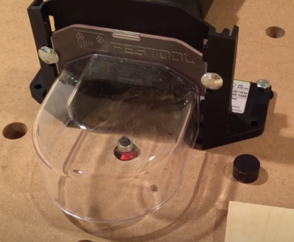
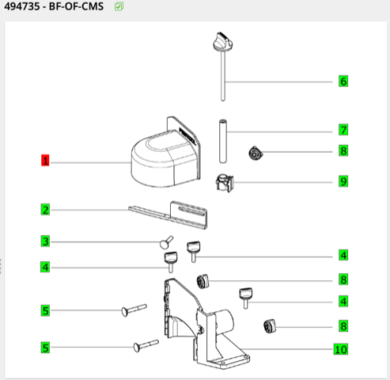

# Todo: Consider a way to mount a router to my Festool MFT with some chip protection and dust collection option mounted on top?

```#ef757ff6``` *As of 2024-03-27 19:44*

[mail plain/text](mail.txt)


So, I have three routers but my home built Makita router table is at my friends house.

1) Consider youtube video "Best Router Table Dust Collection – Toolify Tips" (<https://youtu.be/B7xzzAgSFX0> )?



==&gt; He seems to suggest the following spare parts from Festool in his show notes?

> ►► Part Numbers from Festool EKAT / Spare Parts Catalog ◄◄  
> Item No. 499029 Extractor connector  
> Item No. 472932 Hood  
> 2x Item No. 228534 Screw M6x40  
> 2x Item No. 440712 Knob

2) Consider Festool spare parts available for order to make a chip protection and dust extraction hood (<https://ekat.festool.de/login2/app?__bk_&__windowid=BNC462491827&__rid=KUT1710345620362#2VFB2144C915D47DFAD66CC73CEC1F7E17E1D29351DB45EA618EEFB7B1BB136D42B8044FCE28E6056D>)? )?



> *It seems the extractor connector now has article number 472933 (It fits the description in the image and the *  
> *499029 mentioned in the video above does not match any item when I search Festool EKAT service we page)?*

>   
>   
>   
> 

3) I seem to be able to order these spare parts from Morten Maskin in Täby (<https://www.mortenmaskin.com/festool-produkter/reservdelskataloger> )?

==&gt; I seem to be able to order spare parts for 310 SEK but to have it shipped costs 300 SEK more?!


...


