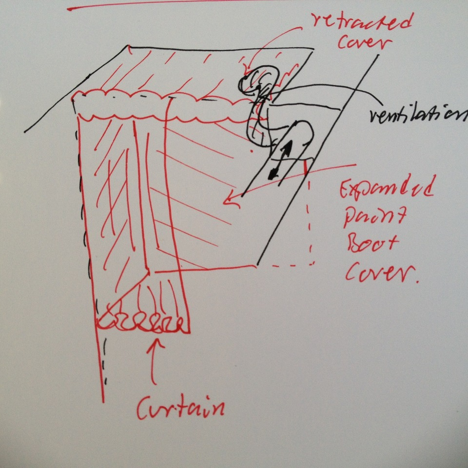

# Todo: Maker Space - Consider a Paint Boot retractable inside cover (to enable boot space to be retractable and reusable for other work)?

```#f12a4af5``` *As of 2018-05-26 17:14*

[mail plain/text](mail.txt)


It seems it could be a good idea to be able to turn some workspace into a paint boot by simply pull down an inside cover to hold paint work isolated from the work space?

1) Consider to design a paint boot cover to fit the a work space against the wall in my indoor cupboard?



==&gt; Consider a design with a front curtain?

==&gt; Consider a design that can be tucked away under the roof?

==&gt; Consider a design that can be ventilated through my existing ventilation outlet?

…

…

Consider to delve into this idea to design and try out a paint-boot-inside-cover that can be tucked away when not used to enable re-using the work space for other work?

...


