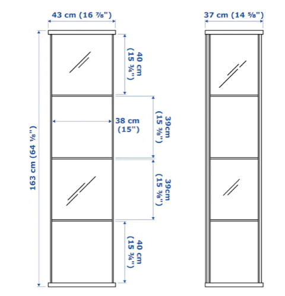

# Todo: Consider that it seems IKEA DETOLF Vitrinskåp 43x163 cm can actually act as 3D printer enclosure for Cetus 3D Printers (four of them in fact)?

```#f17c91d4``` *As of 2022-11-15 21:51*

[mail plain/text](mail.txt)


I need an enclosure for my Cetus 3D printer to be able to print with a heated bed (keep drafts out)

> *From my experiments a Cetus 3D Printer needs an enclosure that is at least 37 cm wide, 40 cm deep and 38 cm high. *

> *And the IKEA IKEA DETOLF Vitrinskåp 43x163 cm seems defined to provide four compartments (shelves) each being *

> *Furter see <https://www.ikea.com/se/sv/p/detolf-vitrinskap-vit-80269122/> .*

> 

> *Now, granted, the 37 cm width is the outside width, so maybe the inside width is in fact too narrow?*

> *Also, to fit inside 37 cm the Cetus 3D printer requires a hole for inlet of the USB cable and power supply. But that we can create with a glass cutter?*

> *Actually, when I study my printer, If we make the openings in the glass wide enough to accept the whole USB-connector, then these can be located outside the enclosure and the printer SHOULD fit well within a few cm less than 37 cm? *


