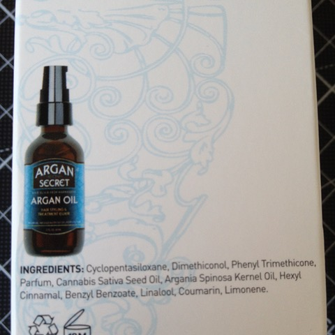

# Todo: Argan Secret Hair Elixir Content - Consider to understand roughly what is in my hair oil "Argan Secret" I bought the last time I had my hair cut?

```#f221b239``` *As of 2018-06-02 19:00*

[mail plain/text](mail.txt)


Judging from the consistence in liquid form and how it feels when dried I get the impression this is actually some kind of Silicone? Can this be so?

Lets Explore!

1) This seems to be the losting on the package of the product?



Cyclopentasiloxane(Decamethylcyclopentasiloxane) (<https://en.wikipedia.org/wiki/Decamethylcyclopentasiloxane>)

Dimethylsiloxane(**Polydimethylsiloxane**) (<https://en.wikipedia.org/wiki/Polydimethylsiloxane>)

Phenyl TriMethicone (methylphenylsilicone,  **polymethylphenylsiloxane**) (<https://pubchem.ncbi.nlm.nih.gov/compound/62427>)

Cannabis Sativa (<https://en.wikipedia.org/wiki/Cannabis_sativa>)

> “the plant is known to contain more than 500 compounds, among them at least 113 cannabinoids”

> “Cannabis sativa seeds are chiefly used to make **hempseed oil** which can be used for cooking, lamps, lacquers or paints. They can also be used as caged-bird feed, as they provide a moderate source of nutrients for most birds."

Argania Spinosa Kernel Oil (<https://en.wikipedia.org/wiki/Argan_oil>)

Hexyl Cinnamal (Hexyl cinnamaldehyde) (<https://en.wikipedia.org/wiki/Hexyl_cinnamaldehyde>)

Benzyl Benzoate (<https://en.wikipedia.org/wiki/Benzyl_benzoate>)

> “Benzyl benzoate is an effective and inexpensive topical treatment for human **scabies**."

Linalool (<https://en.wikipedia.org/wiki/Linalool>)

Limonene (<https://en.wikipedia.org/wiki/Limonene>)

2) So YES - The first three ingredients are all Silicones!

==&gt; I Wonder how much of the product is actually NOT silicone (how much are the rest of the ingredients in total of the whole volume)?

…

==&gt; I imagine the hempseed oil (Cannabis Sativa Seed Oil) is there just to make the product sound exiting (sell more)?

...


