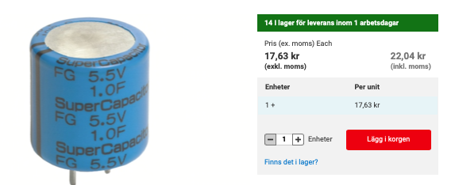
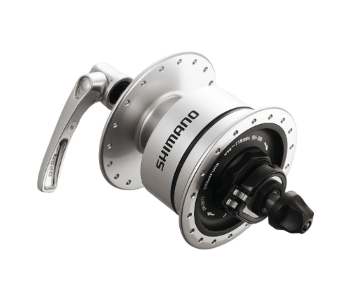
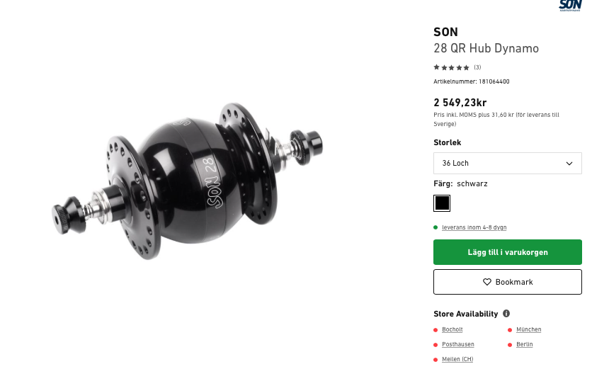
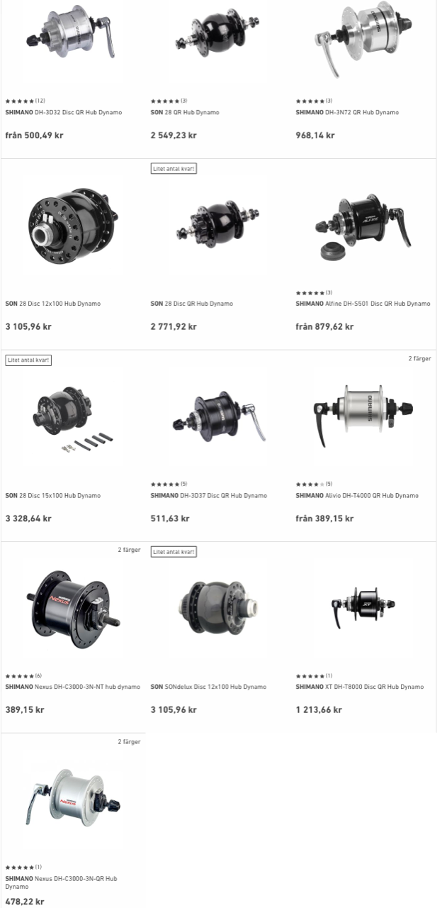

# Todo: Consider some form of regenerative braking on a bicycle to harvest energy to charge batteries for use by lights, bike computer, sensors and other electrically driven devices?

```#f2fc2870``` *As of 2021-08-20 16:27*

[mail plain/text](mail.txt)


I want to drive my electric devices on my bike by harvesting energy I have put into the bike but no longer want to use (like when breaking to get rid of kinetic energy)

1) Consider to imagine some possible designs of regenerative breaking on a non electric bike?

> *The basic idea here is to design some form of electric generator for a bicycle that we can engage with the wheels to "break" by harvesting electric energy from this generator.*

> *Let's imagine some design criteria and constraints we would like to apply to make regenerative breaking feasible on a non electric bike?*

> *1) Generator weight: I imagine we can elaborate with speed, diameter, permanent vs induction magnets and possible a passive vs an active (electrically powered) systems?*

> *2) Generator breaking / harvest power: I imagine the upper limit of breaking power is somewhere around breaking from 30 kph down to zero in say 5s?*

> *This means we would like to take away the kinetic energy mv2/2 for a mass of say 100kg at the speed v = 30kph i.e., 8,3 m/s. This is around 3,5 KJ in 5 seconds or between 650 and 700W!*

> *3) Energy storage speed: I imagine breaking takes place in short quite large power bursts which means a LiIon battery cant charge at the required speed and we need an intermediate electric energy buffer?*

> *Let's imagine we use super capacitors as an intermediate energy storage. What capacitor do we need to store 1000J at say 12V?*

> *Let us **recapitulate that electric volts are Joule / Coulomb and electric current is Coulomb per second and capacitance is Coulomb per volt.*

> Then a one Farad capacitor at 12V charge would contain 12Q. If we discharge this in one second we get 12Q/s or 12A. But while discharging the voltage will drop according to 1 farad = Q/V or V = Q/1.

> So the energy we get out of the capacitor will be the area under the Voltage/Current current graph which ends up being a triangle with the area V\*I/2 (V and I being the initial peak voltage and current).

> So a 1F charged to 12V capacitor can theoretically hold 12V\*12A / 2 = 144J.

> So to store 3,5 KJ we need a 24 Farad super capacitor!!

> 4) Energy losses: I imagine a super capacitor has internal resistance which will produce heat losses when rapidly charging?

> I just took one 1F capacitor I found from RS Components and it seems to state it has an internal resistance of 300 ohms?

> For this capacitor to charge at the speed of 700W at maximum voltage of 5,5V I would need to end charging at 5,5V \* I = 700W or a current of I = 127 amps.

> But this alos means I will start off at even higher currents! Now 127 amps through 300 ohms is a loss off I\*R\*I (Voltage drop I\*R times the current) i.e., 38 kV times 125A! Totally beyond all limits! :)

> At any case, I will need to shop up the current from the regenerative breaking and push it into a inductive load to control the charge voltage (the build up and collapse voltage of the inductor) and have it discharge its inductive energy into the capacitor within the limits of the current load range to not loose to much energy through the internal resistance.

> To make this work I need to either use capacitors in series to allow higher voltage charging (higher generator voltage and subsequently lower charge currents), or use capacitors in parallell to have each accept a smaller charge current but allowing for a large overall current input range.

*==&gt; It seems a 5,5V 1F super capacitor costs around 20 SEK (*[*https://se.rs-online.com/web/p/electric-double-layer-capacitors/7897996/?cm_mmc=SE-PLA-DS3A-_-google-_-CSS_SE_EN_Passive_Components_Whoop-_-(SE:Whoop!)+Electric+Double+Layer+Capacitors-_-7897996&matchtype=&pla-478635641235&gclid=Cj0KCQjwpf2IBhDkARIsAGVo0D1Sb6EXKWVHMJX-pNMHdNa_vRbfLtdtppf_sY1FlGZ5V6OpXTUlorAaApf_EALw_wcB&gclsrc=aw.ds](<https://se.rs-online.com/web/p/electric-double-layer-capacitors/7897996/?cm_mmc=SE-PLA-DS3A-_-google-_-CSS_SE_EN_Passive_Components_Whoop-_-(SE:Whoop!)+Electric+Double+Layer+Capacitors-_-7897996&matchtype=&pla-478635641235&gclid=Cj0KCQjwpf2IBhDkARIsAGVo0D1Sb6EXKWVHMJX-pNMHdNa_vRbfLtdtppf_sY1FlGZ5V6OpXTUlorAaApf_EALw_wcB&gclsrc=aw.ds>) )?*

> 

> Dimensions11 (Dia.) x 5mmLead Pitch5.08mmEquivalent Series Resistance300Ω

2) Consider to use a dynamo hub for regenerative breaking?

> *If we imagine to use a dynamo hub for regenerative breaking it seems we are looking at a breaking power equal to the maximum power output of the hub?*

> *Now the dynamo hubs I have been looking at seems to give out say 6W?*

> *Hm, actually the Hubs I find seems to be able to harvest around 3W?*

> *NOTE: The SON seems to be a luxury brand that costs around 2500 SEK while Shimano costs around 800SEK?*

==&gt; Consider Shimano 2,4W or 3W dynamo hubs (<https://bike.shimano.com/en-EU/product/component/deorelx-t670/DH-3N72.html> )?

> 
- 6V-3.0W: DH-3N72/3D72
- 6V-2.4W: DH-2N80E/2N72


> Average weight 560g

==&gt; Consider the SUN 28 (<https://www.rosebikes.se/son-28-qr-hub-dynamo-551884?product_shape=black&article_size=36+hole> )?

> 

==&gt; It seems I can basically choose between Shimano or SON dynamo hubs (<https://www.rosebikes.se/cykeldelar/lampor/dynamo/navdynamo> )?

> 

...


