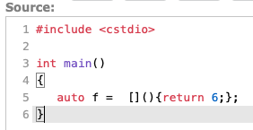
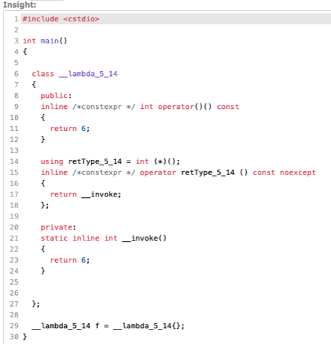

# Todo: C++ - Consider to check out cppinsights web tool that expands C++ code into more elaborated C++ code to reveal insight to what the original code is actually doing (e.g., for lambda expressions)?

```#f4ca522a``` *As of 2020-06-21 13:05*

[mail plain/text](mail.txt)


I found out about this site from Cppcon 2019 talk "CppCon 2019: Jens Weller “Modern C++ Macros”" (<https://youtu.be/uY4iZAuov_I?t=215> ).

1) The cppinsights web tools seems to live here (<https://cppinsights.io> )?

2) Consider how a C++ lambda expressions is expanded into a lambda class by the <https://cppinsights.io> tool?

> 

> Gets expanded into...

> 

...


