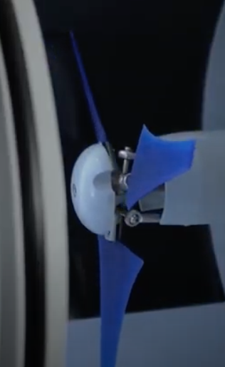
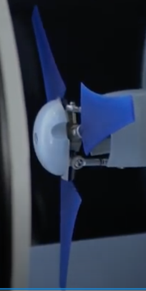

# Todo: Consider to delve into TecQuipment educational Wind Turbine with adjustable and 3D printable rotor blades?

```#f5209cea``` *As of 2020-11-01 13:27*

[mail plain/text](mail.txt)


1) Consider this LinkedIn article (<https://www.linkedin.com/posts/johan-mattsson-beskow-ceo-devinsense-66a3891_wind-turbine-dynamics-launching-soon-motorised-activity-6725379304399638528-JlBd> )?

> *"**ÄNTLIGEN!*

> *Nu kan vi erbjuda en spännande ny unik produkt för utbildning/forskning inom konstruktion/mekanik/aerodynamik och energi- samt förnybara energikällor.

> En vindturbin med ställbara rotorblad! **"*

2) This seems to be the web home of TecQuipment (<https://www.tecquipment.com> )?

> *"**TecQuipment is committed to developing the best products for the practical teaching of engineering principles across the world.**"*

3) Consider TecQuipment youtube channel (<https://www.youtube.com/channel/UCXH4UypSVJOq73jsbMPtq8A> )?

==&gt; Also see youtube video "Wind Turbine Dynamics Launching Soon: Motorised Blade Pitch Preview" (<https://youtu.be/rPJB8uCX_Ks> )?

>    
> *Educational wind turbine from TecQuipment with adjustable turbine blades*

4) Consider is I may want to use teaching equipment from TecQuipment for my own study of Wind Turbine solutions for my own house build?

...


