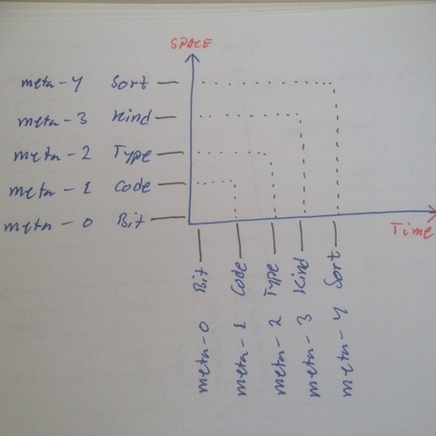

# Todo: Meta System Space Time Distribution - Consider a Meta-layer model of any digital data may be distributed in space (memory) or in time (stream) but still basically remain the same model?

```#f52bbfb5``` *As of 2018-05-08 13:01*

[mail plain/text](mail.txt)


Could it prove to be a valuable insight that any Meta model of digital data can be distributed in space (in memory) or in time (bit stream) but still remain the same model?

1) Consider what we can learn from a Meta Layer model in a space-versus-time diagram?



Hm… A bit strange. In some sense only bits and code (organisation of bits) are actually physically present (all other meta-layers are abstract representations)?

…

2) consider how we can apply the notion of distribution in space versus distribution in time?

==&gt; Consider for a C++ compiler the distribution in space is the actual storage of the C++ type system (as built by the compiler parsing the source code)?

==&gt; Consider for a program that serialises data the data is stored as meta-1 (bit compositions) byt serialised as defined by the meta model type (in some sense executed by meta-3 run-time “generators” that know about structure)?

…

3) Consider meta-2 and upwards are in fact represented as executable code (algorithms)?

==&gt; It would seem that to serialise data as an instance of a meta-stack model there is meta-2 code with a structure that operates according to “type” (meta-2 structure)?

…

4) Consider C++ template functions, function composition and function definition in fact represent execution of code representing a meta-layer model?

==&gt; Consider C++ template function is in fast meta-4 **Sort-of-executable** (parametrised code)?

==&gt; Consider C++ function composition is in fact meta-3 **Kind-of-executable** (algorithms)

==&gt; Consider C++ function declaration is in fact meta-2 **type-of-executable** (compile time dispatch i.e., function as mapping between types))

==&gt; Consider C++ function definition is in fact meta-1-**executable-source**?

==&gt; Consider CPU **machine instructions** are in fact meta-0-executables (could potentially be modelled down to CPU micro instructions…)

==&gt; Consider the **execution** of this code is in fact a **distribution of the meta-layer model in time**?

…


