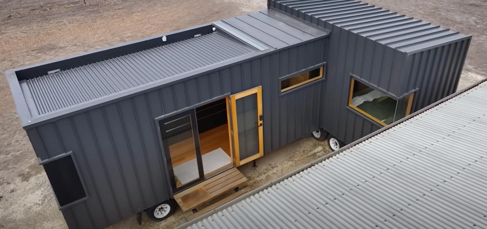
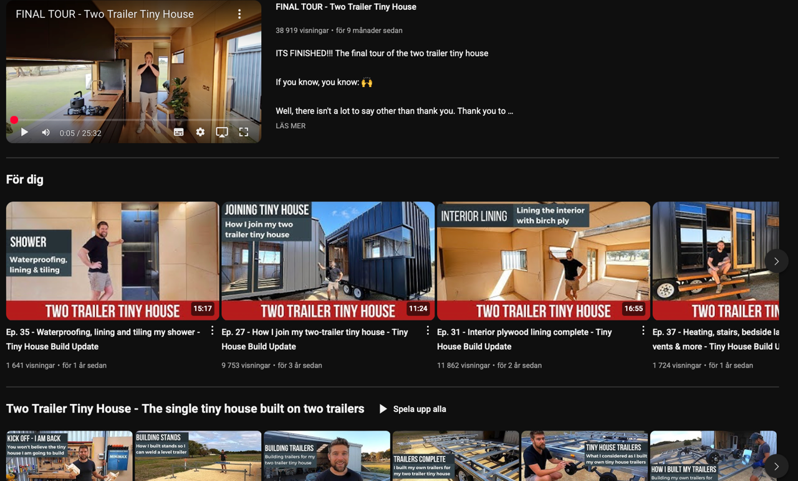
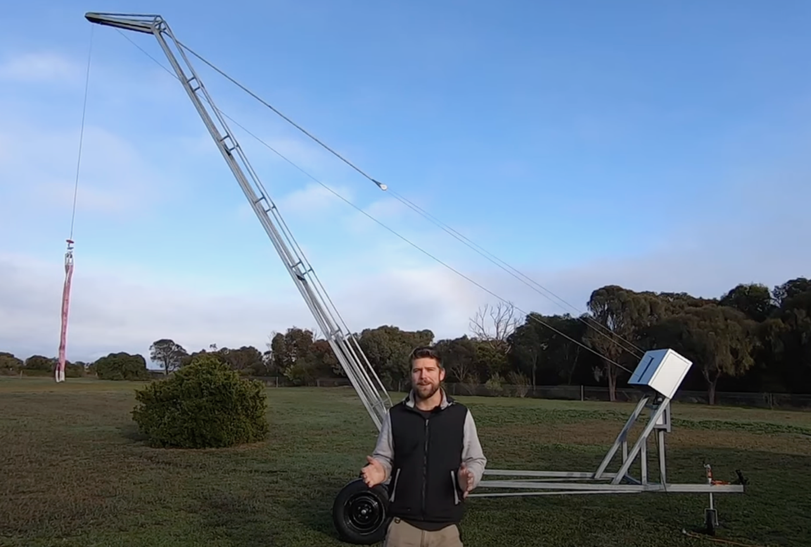
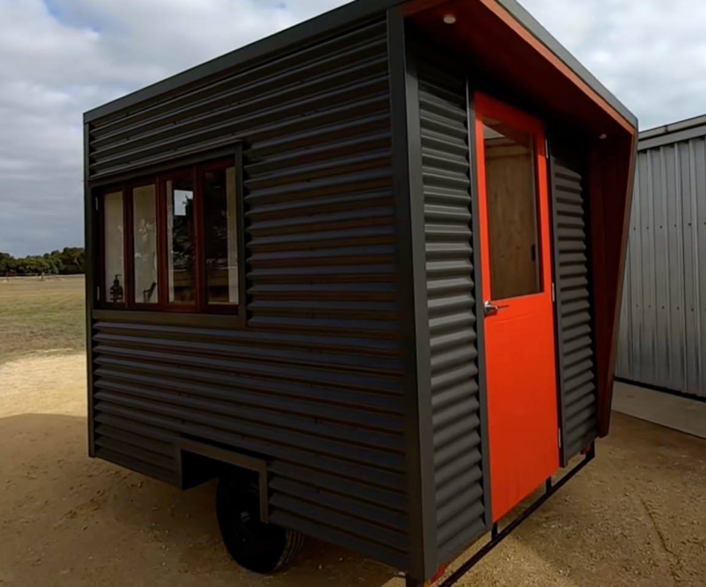
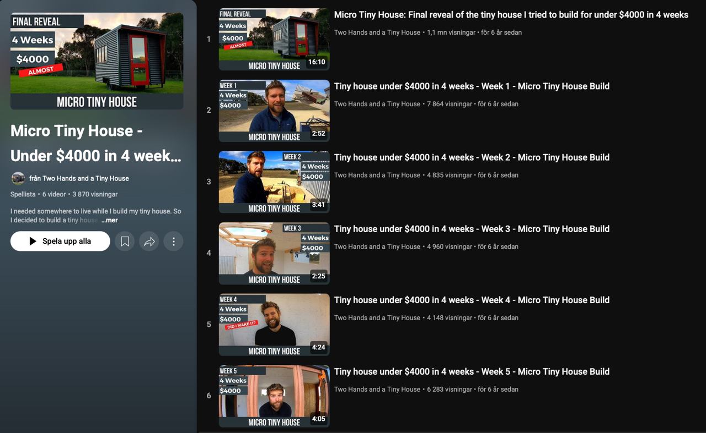

# Todo: Consider to learn from Engineer and tiny house builder with youtube channel "Two Hands and a Tiny House"

```#f5a8347a``` *As of 2025-05-28 10:36*

[mail plain/text](mail.txt)


1) Consider the leads and overview in youtube video "Modern-Minimalist Two-Trailer Tiny Home | A Genius DIY Build That Will Blow Your Mind" (<https://youtu.be/PKteSyfwSU0> )



2) Consider the designers youtube channel "Two Hands and a Tiny House" (<https://www.youtube.com/channel/UCw6VdXXh-x3pMjUGajNdr7g> )



3) Consider the tiny crane the designer built for his tiny house build in "Ep. 07 - I built a smart crane that's controlled a smartphone - Tiny House Build Update" (<https://youtu.be/ecNv60eqss8> )?



4) Consider to study the micro tiny house the designer built first to live in while building the actual tony house (<https://www.youtube.com/playlist?list=PL_UryR-BJnkBMbQr7rjAOzNY2ZeWtoL6c> )?






