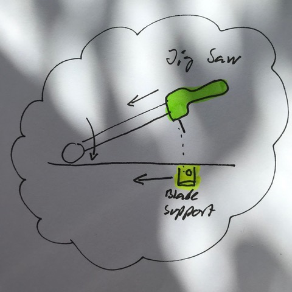

# Todo: Consider a jig saw based miter saw station (with jig saw blade support that moves with the saw through the cut stroke)?

```#f74d369e``` *As of 2019-06-04 09:59*

[mail plain/text](mail.txt)


Maybe we can imagine a mechanism to have an "above" jig saw and a "below" blade support move together to enable straight blade supported jig saw cuts?

==&gt; Also see "[Todo: Consider a motorised hand held saw like a European push saw or a Japanese nokogiri pull saw (e.g. the double blade Ryoba saw)?](../eb9bd655/chime.md)"

1) Consider the idea of a jig saw based miter saw station with underside blade support moving with the saw?



*A "from above" jig saw moving together with a "from below" blade support*

> *The idea here is to make a mechanism so that we can use the jig saw mounted on some form of rail to restrain it to a straight cut path and at the same time have a blade support holde the blade from the underside. In this way teh jig saw blade would be firmly supported both at the jig saw drive side and at the blade support side, enabling the blade to be stabilised along the cut and thus ensuring a more exact and straight cut.*

2) Consider possible designs of the blade support?

==&gt; Consider a motorised blade support moving in sync with the jig saw blade?

> *Could it be possible and also functionally beneficial to have the jig saw blade support to be motorised and thus help driving the blade in sync with the saw motion?*

3) Consider mechanisms to have the jig saw and the blade support move on concert?

==&gt; It seems we should be able to have the blade support to move in parallel with the jig saw through some system of wires?

> *Maybe the simplest way to make the blade support move in concert with the jig saw is to have it attached to a rail just as the jig saw and then connect the two with wires so that they move in sync? I imagine we can "just" make a wire loop and attach the jig saw and the blade support to the same loop having them move exactly the same distance and in the same direction at all times?*

...


