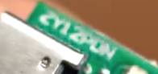
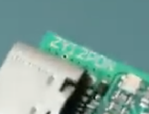
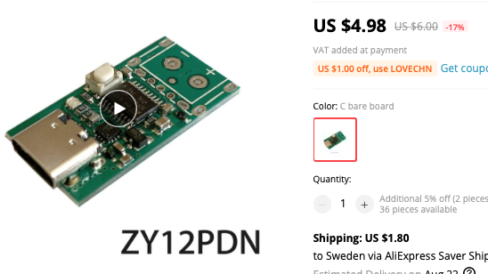

# Todo: Consider USB-C Receiver Trigger Boards to utilise USB-C output Powerbanks for 5, 9, 12, 15 and 20V power output configurations?

```#f7e0b1f6``` *As of 2021-07-16 14:06*

[mail plain/text](mail.txt)


1) Consider youtube video "USB Type-C Power Delivery Trigger Board || DIY or Buy" (<https://youtu.be/DQLrZA5RMjQ?t=61> )?



==&gt; He seems to be using a board labelled ZY12PDN?

2) Consider youtube video "Building DIY LED lights" (<https://www.youtube.com/watch?v=Y06VHj1GvLI> )?



==&gt; He seems to be using the same ZY12PDN??

3) Consider the ZY12PDN available from Aliexpress (<https://www.aliexpress.com/item/4001244296837.html?spm=a2g0o.productlist.0.0.4fb732d0dRPXqh&algo_pvid=39bae0c0-57fb-46f1-8327-73dda1fa9164&algo_exp_id=39bae0c0-57fb-46f1-8327-73dda1fa9164-11> )?



...


