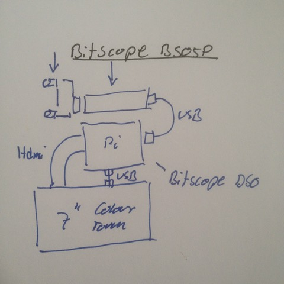

# Todo DIY Open Oscilloscope - Consider to check out Bitscope on Raspberry Pi?

```#fb117517``` *As of 2018-05-03 11:43*

[mail plain/text](mail.txt)


It seems the BitScope USB/LAN connected SBC data capture products provide Raspberry Pi supported frontend GUI that enables us to put together a DIY Bench MSO Oscilloscope?

==&gt; Also see “[Todo: Electronic Lab - Consider to check out the sigrok open source PC/MAC/Linux instrumentation software for a large set of electronic measurement hardware devices?](../bf58bea1/chime.md)”

==&gt; Also see “[Todo: Consider to check out Chineese Min company that sell those mini screwdriver, soldering iron and oscilloscope that Macro Reps done reviews on?](../d50b728f/chime.md)”

==&gt; Also see “[Todo: Electronic Lab - Consider to find a good enough Lab Oscilloscope?](../9e71efd1/chime.md)”

==&gt; Also see “[Todo: Electronics Lab - Consider Oscilloscope brands of common web-shops?](../6ed63735/chime.md)”

==&gt; Also see “[Todo: Electronics Lab - Consider to buy and use a PC/USB Oscilloscope?](../1e289e9c/chime.md)”

1) This seems to be the home of BitScope products ([http://bitscope.com](http://bitscope.com/))

…

2) Consider a Proof of Concept?



==&gt; Consider Ben Hacks Show “Ben Heck's Raspberry Pi Bitscope Mod” showing a BitScope + RaspBerry Pi Bench Scope Build (<https://www.youtube.com/watch?v=69CWPGQ_nto>)?

==&gt; Consider the $165 Mixed Signal Problems with 2 chan analog Probe hammerhead (<http://bitscope.com/product/BS05/>)


==&gt; Consider the Raspberry Pi 7” colour touch screen (<https://www.dustin.se/product/5010882000/7-touchscreen-display?ssel=false&gclid=Cj0KCQjw5qrXBRC3ARIsAJq3bwoBsidFk7V03NZj-b7MKZSMaUe6BX05lEM-b22y7M9KxqQdTF-OL2YaAnycEALw_wcB>)?


==&gt; Consider this BitScope software to run on Raspbian?

3) Consider a more professional design for a Bench MSO Oscilloscope?

==&gt; Consider a GeChic 11”, 13” or 15” 1080p colour touch display (<https://www.gechic.com/en-product-touchmonitor.html>)?

==&gt; Consider this youtube video “” showing a GeChic 15” touch display on a Raspberry Pi (<https://www.youtube.com/watch?v=LCGOcFr_BuE>)?


==&gt; Consider $245 BitScope 2 analogue 100 MHz Mixed Signal USB (<http://my.bitscope.com/store/?p=view&i=item+3>)


4) This seems to be the available software to download for Raspbian ARM (<http://my.bitscope.com/download/?p=download>)?


…


