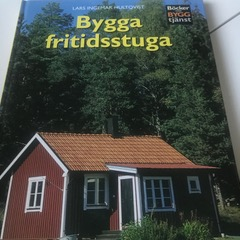

# Todo: Own house build - Consider to study and learn house construction by mimic existing designs (prefab Friggebod, Attefall, ICA "Bygga Fritidsstuga" ...)?

```#fb5da175``` *As of 2019-06-02 21:47*

[mail plain/text](mail.txt)


Maybe I can force myself to stay focused and learn house construction by mimicking existing designs like prefab Friggebod, Attefallshus, ICA book "Bygga Fritidsstuga" and so on?

1) Consider Bauhaus prefab friggebod products (

==&gt; Consider this Friggebod (<https://www.bauhaus.se/media/pdf/6204753A.pdf> )?


==&gt; Consider this storage shed (<https://www.bauhaus.se/forrad-palmako-leif-4-6m-273x230x170cm> )?


2) Consider prefab timber frames from [byggstommar.se](http://byggstommar.se) (<http://byggstommar.se> )?


3) Consider the ICA book "Bygga Fritidsstuga"?



4) Consider to kick-start storage on my new property by using a prefab tin shed?

==&gt; Consider Bauhaus tin sheds EUROPA system (<https://www.bauhaus.se/utemiljo/forvaring-stugor/redskapsbodar?serie=EUROPA> )?


<https://www.bauhaus.se/redskapsbod-europa-morkgron-storlek-3-222x150-cm>


<https://www.bauhaus.se/aluminium-bottenram-till-europa-redskapsbodar-244x156cm>


<https://www.bauhaus.se/aluminium-bottenplatta-till-europa-redskapsbodar-244x156cm>

- Biohort GMBH0,00 kr
  - BOTTENPLATTA EUROPA STORLEK 3  
>     x 1  
>     3 495,00 kr
  - REDSKAPSBOD BIOHORT EUROPA SILVER METALLIC STORLEK 3 3,81M²  
>     x 1  
>     9 990,00 kr
  - BOTTENRAM TILL EUROPA STORLEK 3  
>     x 1  
>     1 799,00 kr

> Ordervärde15 284,00 kr

...


