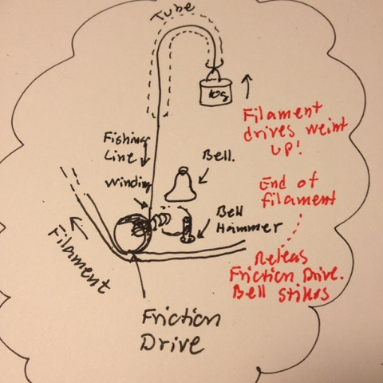

# Todo: Consider a mechanical 3D printer out-of-filament alarm using a friction winding mechanism and a bell that is struck on filament end and mechanism unwinding?

```#fbb43a6b``` *As of 2018-12-12 22:22*

[mail plain/text](mail.txt)


It seems like a fun idea to have a mechanical out-of-filament alarm that works only by using the energy of the feed filament that is released on end-of-filament?

1) Consider a mechanical design based on a friction wheel driven by the filament feed that winds up the rising mechanism?



==&gt; Consider a friction wheel driven by the filament feed?

==&gt; Consider the friction wheel winds up a fishing line?

==&gt; Consider the fishing line is attached to a small weight that is lifted when the line winds up?

==&gt; Consider the friction of the friction wheel is so small that the winding stops when the weight is lifted to its highest position?

==&gt; Consider the friction wheel spins freely when the end go the filament has passed the friction wheel (no filament to grab on to)?

==&gt; Now consider the centrifugal force of the unwinding causes a small hammer to strike a small bell repeatedly (alarm clock style)?

...

2) Consider to find the BOM for an experiment with this mechanical end-of-filament alarm?

A small bell (A Christmas bell or a bell for a cat)?

Two small friction wheels (filament feed detection)

A fishing line winding (a simple axes)

A bell-hitting hammer with wheel (hammer must be metal)?

1 m Fishing line?

One or two simple M10 nut (or something similar small but sufficiently heavy weight)

A 10 cm tube for fishing line travel and weight lifting stop.

Some mechanism housing for the whole thing (3D printed)?

…

...


