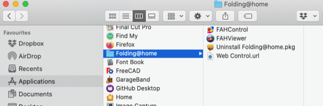
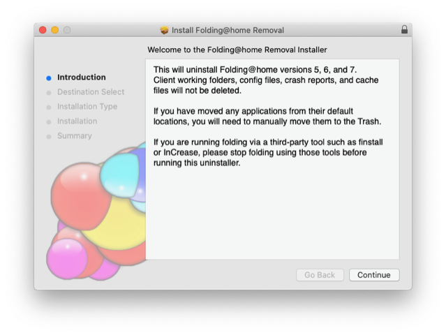
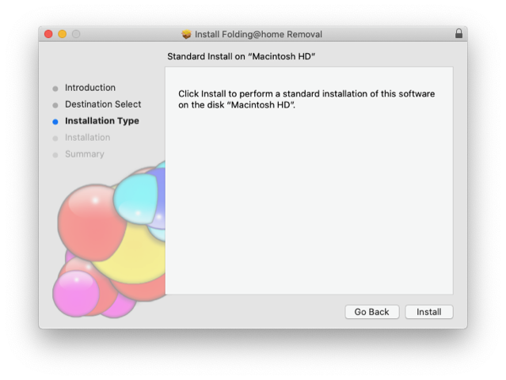
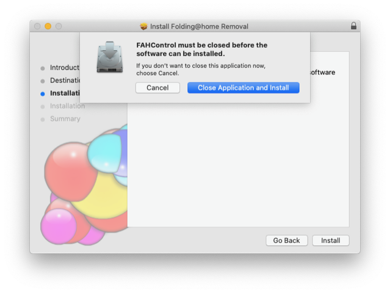
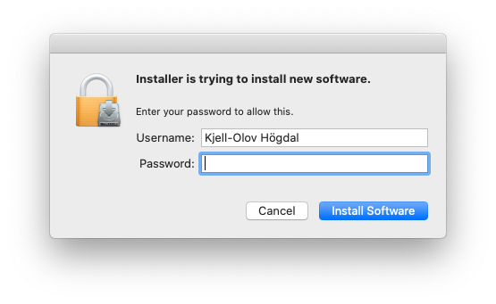
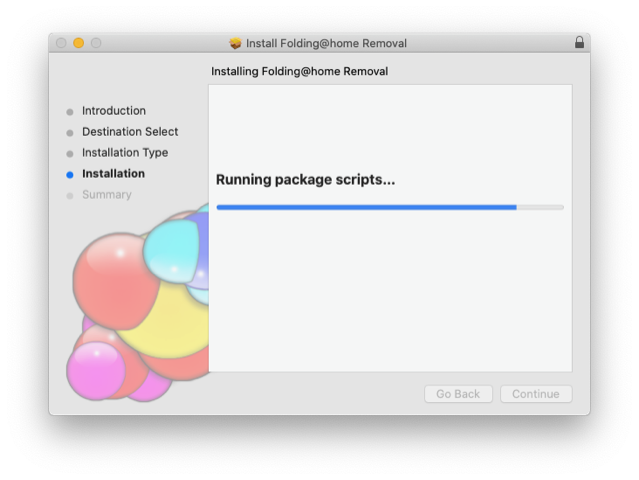
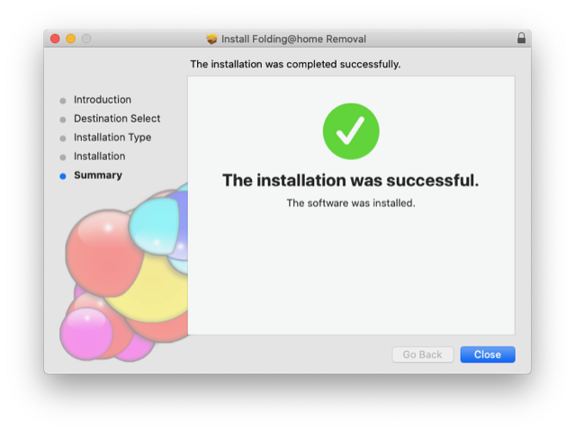
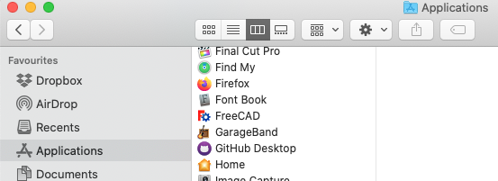
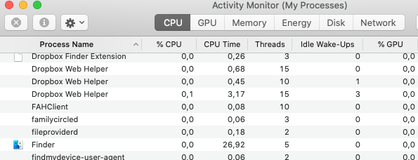
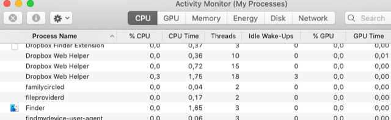

# Todo: Consider to document how I uninstalled the "folding@home" software I had previously installed on my Mac Pro 2013?

```#fcb6e594``` *As of 2020-06-22 12:54*

[mail plain/text](mail.txt)


My Mac Pro has been restarting for no obvious reason and I suspected it had something to do with the background process that gets installed with the "folding@home" software I installed in March 2020.

1) The folding@home project seems to live here ([https://foldingathome.org](https://foldingathome.org/) )?

2) Consider I had to re-install the software to find the uninstallation script again?

==&gt; So for some reason I could not find the installed software although I still suspected it was still running in the background?

> *I searched for any file named "FAH..." and found several folders and files but no uninstall script. It did not occur to me to check the running processes.*

> *Instead I re-installed the software in the hope it would overwrite and clean up any old files I had from the March installation.*

==&gt; Consider to document the installation files I got from installing the "fah-installer_7.6.13_x86_64.pkg" package (<https://foldingathome.org/start-folding/> )?

> *After running the installation script in the package I now had an uninstall script together with the *

>   
> *The FAHControl and FAHViewer application installed from **the "fah-installer_7.6.13_x86_64.pkg" package (<https://foldingathome.org/start-folding/> )*

>   
> *An uninstall script in "Uninstall [Folding@home.pkg](mailto:Folding@home.pkg)" package is present in the macOS installed files (from **the "fah-installer_7.6.13_x86_64.pkg" package)*

>   
> *Running the script in **"Uninstall [Folding@home.pkg](mailto:Folding@home.pkg)" - step 1*

>   
> *Running the script in **"Uninstall [Folding@home.pkg](mailto:Folding@home.pkg)" - step 2*

>   
> *Pressing &lt;Install&gt; warns about having to stop the FAHControl process*

>   
> *macOS requires user authorisation to allow "Install" (as in this case uninstall)*

>   
> *The "Uninstall [Folding@home.pkg](mailto:Folding@home.pkg)" executes its uninstallation scripts*

>   
> *The "Uninstall [Folding@home.pkg](mailto:Folding@home.pkg)" uninstall script confusingly reports successful "Installation"...*

>   
> *After having run the "Uninstall [Folding@home.pkg](mailto:Folding@home.pkg)" script the macOS Application folder no longer contains the "Folding@home" folder*

>   
> *After having run the "Uninstall [Folding@home.pkg](mailto:Folding@home.pkg)" script the macOS activity monitor shows an "FAHClient" process*

>   
> *After having restarted the Mac the **"FAHClient" process is no longer present ok :)*

..

.


