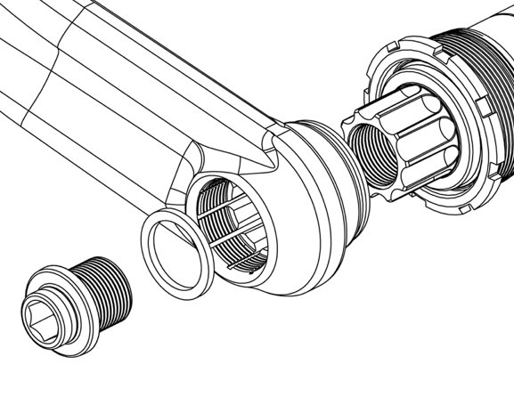
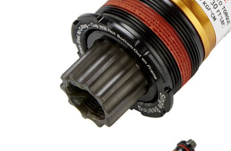
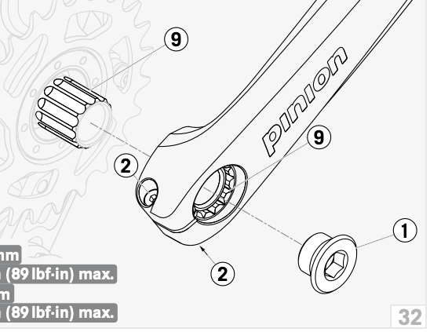
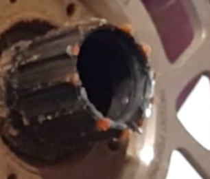
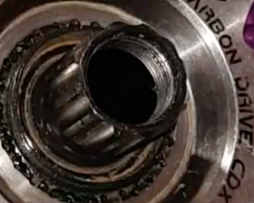
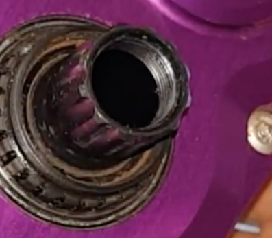
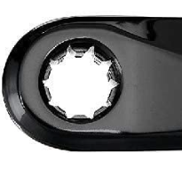

# Todo: Consider to investigate if the Pinion gearbox drive (crank) sports a spline interface compatible with ISIS (or other manufacturer crank interfaces)?

```#fcbcddf4``` *As of 2021-08-07 19:06*

[mail plain/text](mail.txt)


0) Consider to read the actual open source ISIS Drive specification ([http://my-sport.spb.ru/manual_1/ISIS%20Drive%20Complete%20Rev%20D.pdf](<http://my-sport.spb.ru/manual_1/ISIS Drive Complete Rev D.pdf>) )?

> 

>   
> 

1) Consider this to be a good example of the ISIS spline design (<https://www.bikester.se/truvativ-giga-pipe-team-sl-bottom-bracket-bsa-1.37-M190796.html?_cid=21_1_-1_9_146_225246_478735846944_pla&ef_id=CjwKCAjw3riIBhAwEiwAzD3TiVkHhXB-NzA9w1Iieq-WPjtl9V1OpOmFg9NJ-zqO6ZmSWhNfTVHizRoCD5UQAvD_BwE&ev_chn=shop&campaign_detail=shopping&gclid=CjwKCAjw3riIBhAwEiwAzD3TiVkHhXB-NzA9w1Iieq-WPjtl9V1OpOmFg9NJ-zqO6ZmSWhNfTVHizRoCD5UQAvD_BwE> )?

> 

2) Consider The Pinion gearbox does in fact implement the ISIS Drive for its crank shaft (<https://pinion.eu/PDF/Pinion-C-Line-user-manual-C1_09_2017_en.pdf> )?

> 

3) Consider this youtube video "" showing the Pinion Gearbox drive axix and crank mount (

>    
>   
> The Pinion Drive axis seems to sport 10 notches and 10 splines (just as the ISIS Drive specifies)?

4) Consider images of the Pinion crankset to determine the spline design (<https://pinion.eu/en/accessories-2018/#module-id-4> )?

>   
> Hm... The actual crank arm seems to have 11 or 12 notshes and 11 or 12 splines?

==&gt; Consider the FSA E-bike crank spine interface (<https://www.amazon.se/FSA-Unisex-CK-745-Bike-kedjeset/dp/B01G3GK1L2> )?

>   
> The FSA CK-745 is referred to as BB-99200 ISIS and has 10 notches and splines as specified also in ISIS specification.

...


