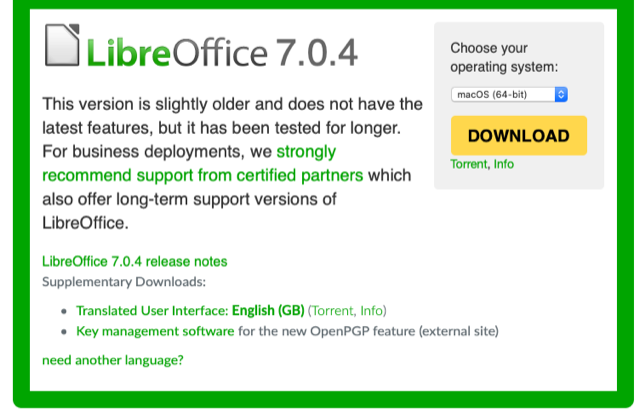

# Todo: Consider to check out the "LibreOffice 7.1 Community released by The Document Foundation"

```#fe2bc3c2``` *As of 2021-02-10 10:02*

[mail plain/text](mail.txt)


1) Consider the article "LibreOffice 7.1 Community released by The Document Foundation" (<https://blog.documentfoundation.org/blog/2021/02/03/libreoffice-7-1-community/> )?

2) Libre Office seems to be available here (<https://www.libreoffice.org/download/download/> )?



*It seems Libre Office 7.0.4 is the "stable" version?*

3) It seems LibreOffice is written in C++ (<https://youtu.be/-5hVXeHNt2M?t=389> )?

4) It seems LibreOffice provides an SDK for automation from several different languages like C/C++, Java, Python (<https://api.libreoffice.org/examples/examples.html> )?

...


