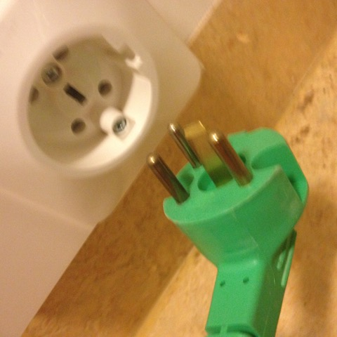

# Todo: Welding in apartment - Consider to implement a Battery Bank to provide the current required by a Welder (to be able to use low current mains)?

```#fe56153c``` *As of 2018-11-02 17:35*

[mail plain/text](mail.txt)


Could it be possible to provide the current requirements by a welder by driving it from a battery bank “buffer”?

==&gt; Also see “Todo: Maker Space - Överväg att köpa Everlast PowerArc 200ST TIG/STick svets från leverantör i Umeå?"

==&gt; Also see “Todo: Cordless Tool Batteries - Consider to buy batteries from different cordless platforms and disassembly them to compare them? "

-1) Consider to buy a cheap Stick/TIG AC inverter welder and convert to a Battery driven one?

==&gt; Consider an AC TIG welder so that I can weld aluminium (I heard somewhere that you need AC welding for Aluminium)?

==&gt; Consider to do an experiment with a cheap inverter welder and just unplug the rectified input and replace it with a suitable battery pack?

...

1) Consider a battery bank could be a way to buffer the required amperage required by a welder although the mains available is insufficient?

==&gt; Consider in my apartment I have a 10A restriction on the mains 220V AC.

==&gt; So I will be unable to power a welder that may require 40A or higher (e.g., the PowerARC 200ST)?

==&gt; NOTE: To large for my Apartment (The stove is 3x16A and all other outlets are 1x10A)!

==&gt; But if a remove the welder rectifier and power the DC input from a Battery Bank I may be able to provide the amperage it?

…

2) Consider to drive a welder from the same 3 x 16 A that my stove uses (and never use stove and welder at the same time)?

==&gt; It seems I should be able to enter just disconnect the stove (and connect a welder instead)?



3) Consider the DC Voltage and amperage required by the rectified input of the Welder?

==&gt; Consider the PowerARC 200ST states an open circuit voltage of 74V?


==&gt; And the Max power consumption (peak) is roughly 40A \* 220V = 8,8 kW?

==&gt; But the running power consumption is 23,7A \* 220V = 5214 W?

==&gt; Now, Asume we need to provide &gt;= 74V (open circuit) to the rectified DC input of the welder?

==&gt; Using Led accumulators we can build a bank of **6 \* 12V** = 72V?

==&gt; Using Li-Ion cells we can build a bank of **20 \* 3.7V** = 74V?

==&gt; And we need to be able to provide 74\*I = 5214W, I = **71A**

==&gt; On the other hand - Output running voltage is stated to be 20,8V .. 28V?

==&gt; Using Led accumulators we can build a bank of **3 \* 12V** = 36V?

==&gt; Using Li-Ion cells we can build a bank of **9 \* 3.7V** = 33,3V?

==&gt; And we need to be able to provide 30\*I = 5214W, I = **174A**

**hm...**

…

4) Consider the Wh requirements of the battery bank?

==&gt; Suppose we would like to weld for 15 minutes (continuously)?

==&gt; Note that each weld is normally only second up to say max a minute at a time?

==&gt; Maximum energy requirement for 35% duty cycle is 200A \* 28V \* 0,35 \* 0,25 (15 minutes) = 5600W \* 35% \* 1/4h = **490 Wh**?

==&gt; Maximum energy requirement for 60% duty cycle is 160A \* 25V \* 0,60 \* 0,25 (15 minutes) = 4000W \* 60% \* 1/4h = **600 Wh**?

==&gt; Maximum energy requirement for 100% duty cycle is 130A \* 20,8V \* 1 \* 0,25 (15 minutes) = 2704W \* 100% \* 1/4h = **676 Wh**?

==&gt; So, a Lead Pack of 3 x 12V \* X Ah = 700 Wh ==&gt; 3 x Cell of 12V, 19,5 Ah (36V, 19,5 Ah)

==&gt; So, A Li-Ion pack of 9 x 3.7V \* Y Ah = 700 Wh ==&gt; 9 x Cell of 3.7V, 21 Ah (33V, 21 Ah)

==&gt; Using Sony 18650 Cells with 3 Ah capacity we need 7 cells in parallel = 21 Ah ==&gt; 9 x 7 x Cell of 3,7V, 3 Ah (699 Wh)

5) Consider to compare with Fronius AccuPocket (<https://www.youtube.com/watch?v=hohRgZ-JlfM>)?

==&gt; They seem to state it comes with a Li-Ion battery pack of **400 Wh**?


==&gt; Pritty Close to the 490…676 Wh I calculated above :)

==&gt; Consider ChuckE2009 video “A Practical Battery Powered Stick Welder! The Fronius Accupocket 150 Is Amazingly Portable!” on Fronius AccuPocket (<https://www.youtube.com/watch?v=aYe2yL1--JQ>)?

6) Consider this guy “MIG welder - DC 24V battery convertion test” that actually powers a Güde TIG welder with 24V car batteries (<https://www.youtube.com/watch?v=3iXE3Zs1eT8>)?

==&gt; He seems to have converted a Güde EasyMig125/A welder?


==&gt; And just disconnected the transformer and replaced it with 24V battery DC power?


7) Consider the price of building the Battery “buffer” for a welder?

==&gt; Consider Biltema Lead 12V, 18Ah for 500 SEK ==&gt; 3 x Cell of 12V, 18 Ah (648 Ah) for **1500 SEK **(<http://www.biltema.se/sv/Bil---MC/El/Batteri-ovriga/Blyackumulatorer-2000018765/>)?

==&gt; Consider GearBest Sony 18650 Cells - 8 cells 312 SEK ==&gt; 8 x 8 = 64 Cells for 2500 SEK (<https://www.gearbest.com/batteries/pp_571931.html?lkid=12505301>)?

==&gt; Consider we actually need 10 cells to allow them to drop to 3V (to still get 10 \* 3 = 30V when discharging)

==&gt; We need 10 x 7 = 70 cells (7 in parallel times 10 in series)

==&gt; Consider GearBest Sony 18650 Cells - 8 cells 312 SEK ==&gt; 9 x 8 = 72 Cells for **3000 SEK** (<https://www.gearbest.com/batteries/pp_571931.html?lkid=12505301>)?

==&gt; Consider verktygsproffsen Makita power tool Li-Ion packs 18V, 4 Ah for 500 SEK ==&gt; 10 packs for **5000 SEK** (<https://www.verktygsproffsen.se/produkt/Makita-Batteri-BL1840-18v-4Ah>)

…

8) Consider to guarantee a battery pack that can provide the peak and continuos current?

==&gt; We need to be able to provide 30\*I = 5214W, I = **174A**

==&gt; The Sony Li-Io seems to be rated to provide 15A continuous and 30A peak current.

==&gt; We are using 10 in parallel ==&gt; 150 A continuous and 300A peak current (should suffice)?

==&gt; The Biltema Lead 12V 18Ah batteries seems rated for max 72A discharge (<http://www.biltema.se/biltemadocuments/technicaldatasheets/80413_TDS.pdf>)?

Hm… Thus we need 2 in parallel to get at least 140A discharge?

==&gt; Consider Biltema Lead 12V, 18Ah for 500 SEK ==&gt; 2 x 3 x Cell of 12V, 18 Ah (648 Ah) for **3000 SEK **(<http://www.biltema.se/sv/Bil---MC/El/Batteri-ovriga/Blyackumulatorer-2000018765/>)?

Hm…Interesting (The different alternatives are closing up)?

…

…

Consider to continue to delve into this idea of designing a DC battery bank to provide the amperage need for a Welder?

...


