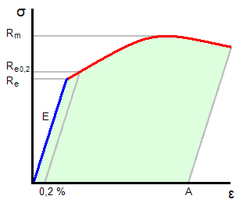

# Todo: My House Build - Consider to refresh my understanding of mechanics of materials, buckling and shearing to be able to model the support on pillars for my house build?

```#ff11b313``` *As of 2019-07-15 19:23*

[mail plain/text](mail.txt)


1) Consider to navigate though my old knowledge to freshen up my understanding of mechanical structure behaviour?

==&gt; Consider to understand why the Elastic Module has the dimension of Pressure N/m2 (newton per square metres)?

> *From the definition of the Elastic Module E = stress/strain where the stress is the pressure N/m2 and strain is dimensionless we directly see that E has the dimension of stress i.e., pressure i.e., force per area. But what the heck was strain no again?*

==&gt; From the Swedish version of the wikipedia article on the Elastic Module I can recognise the greek letters and terms used (<https://sv.wikipedia.org/wiki/Elasticitetsmodul> )?

> *In the Swedish version I recognise the terms and the greek symbols used for the Elastic Module definition. It is written as,*  
> 

> *Where little sigma σ is the stress as a negative (pull) pressure (Newton per square meters) exerting a lengthening force and epsilon ε is a dimensionless "scaling" factor (strain).*

> *Now this still does not satisfy my need to intuitively get this. It looks like E is independent on the dimensions of the material we are modelling? So to, let's say, try to predict the length deformation of a rod with the elastic module E we need to provide the lengthening pressure as well as the dimension of the rod. If the rod has the cross sectional area of A uniformly. And we apply a pulling force F. Then we have applied a pulling force of F/A on the rod. If the rod is made of aluminium it has an E specified as 69 GPa. What does this even mean?*

> *My intuition tells me that because E is a material property that does not depend on the dimensions we need to use it in some integration over the actual volume we are modelling. Like for our uniform aluminium rod the pressure pulling at the end of the rod is in equilibrium with the negative pressure applied by the rod as a result of its extension.*

> *For this to make sense we need E to actually be defined as E = d**σ / dε in the linear part of the deformation curve. That is the part where the material is elastic and does not deform plastically. And we can confirm this from the wikipedia article showing a diagram of **σ* *vs ε for some material.*

> 

> *The graph seems to indicate that as long as no plastic deformation occurs (the red zone) the blue line is the linear relation between the materials "resisting" pressure σ and the dimensionless deformation ε. For this to make sense ε must be about the deformation in the direction of the pressure pulling at the material? In this way we can understand ε as some factor that models the length deformation of the rod (longer or shorter depending on wether we pull or push on it)?*

> *Looking up the actual definition of the strain ε we see it is the natural logarithm of the lengthening factor (deformed length / initial resting length).*

>   
> Where the reason for using a logarithmic measure is that sectional *ε length deformations will add (while the factors compose with multiplication).*

> *I would bet that to get the actual resting pressure at the end of the rod I need to integrate the dE/d**ε* *over the length of the rod? But that does not actually make sense. It is more like we need to integrate **E = d**σ / dε over the length of the rod. Or rather dP = E **dε?*

> *We should now be able to write **dε = (**dε / dL) dL. **Now I had forgot but re-learned that d/dx ln(x) = 1/x, so we get **dε/dL = 1/(L/L0) dL = L0/L dL. And if we integrate E (**L0/L) dL from L0 to L2 we get E **(L0/L2 - 1) **.*

> *If the Aluminium rod was 1m long (L0 = 1m) and we solve for **E **(L0/L2 - 1)* *= F/A we can get a function of how the rod stretches given an applied pull force F as { } L2(F) = E\*L0 / (E-F/A).*

> *Hm... Ok, so this is not the interesting equation we like to use. We want the length deformation (L2 - L0) as a function of F.*

> *From **E **(L2 - L0) **/ L2 = F/A we get **(1 - L0/L2) * *= (F/A) / E = 1/E \* F/A. Which tells us that the lengthening factor ΔL / L...*

> *Hm... No, this does not add up I think. *

> *Ok so my math is a bit rusty! I have to come back to this when I have refreshed my derivation and integration skills!*

> *...*

2) Consider the wikipedia article on the Elastic Module (<https://en.wikipedia.org/wiki/Elastic_modulus> )?

3) Consider the wikipedia article on strength of materials for leads into the science (<https://en.wikipedia.org/wiki/Strength_of_materials> )?

4) Consider the wikipedia article on Buckling (E.g., Euler buckling modes) for leads into application for my house structural design and support (<https://en.wikipedia.org/wiki/Buckling> )?

5) Consider the wikipedia article on material Shear Modulus (modulus of rigidity) (<https://en.wikipedia.org/wiki/Shear_modulus> )?

...


