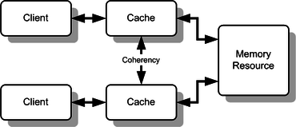

# Todo: Darwinet - Consider to study multiple CPU memory cache algorithms to compare them with Darwinet delta synchronization issues?

```#ffa22305``` *As of 2016-02-10 12:15*

[mail plain/text](mail.txt)


Could it be a good idea to view Darwinet MIVs as ”synchronized caches” of shared data?

1) Each Darwinet View should regard its MIV as THE data to operate on (although behind the scenes it behaves like an asynchronous cache)?

2) Consider to compare this with multiple CPU caching where correct program, execution requires coherent cash state (<https://en.wikipedia.org/wiki/Cache_coherence>)?



3) What can we tell from the Darwinet approach to apply MIV (cache) ”catch-up” ”synchronization?

==&gt; Darwinet allows (encourage even) each MIV to branch as mutated by the local clients.

==&gt; Synchronization through the domain of MIVs happens asynchronously in the background

==&gt; Darwinet provides auto-merge mechanisms for not conflicting mutations.

==&gt; Darwinet may provide auto-merge strategies also for conflicting mutations (e.g. merge conflicting states into the main trail with the last produced one as current main state)

4) What can we learn from studying the protocols available for Cache Coherency (<https://en.wikipedia.org/wiki/Cache_coherence>)?

”Various models and protocols have been devised for maintaining coherence, such as MSI, MESI (aka Illinois), MOSI, MOESI, MERSI, MESIF, write-once, and Synapse, Berkeley, Firefly and Dragon protocol.&#91;1&#93;:30–34 In 2011, ARM Ltd proposed the AMBA 4 ACE&#91;10&#93; for handling coherency in SoCs."

5) What can we learn from known Consistency Models and what applies best to Darwinet MIV synchronization (<https://en.wikipedia.org/wiki/Consistency_model>)?

• 2.1 Strict consistency

• 2.2 Sequential consistency

• 2.3 Causal consistency

• 2.4 Processor consistency

• 2.5 PRAM consistency (also known as FIFO consistency)

• 2.6 Cache consistency

• 2.7 Slow consistency

• 2.8 Release consistency

• 2.9 Entry consistency

• 2.10 General consistency

• 2.11 Local consistency

…

Consider to study this field of solutions for cache synchronization to see what we can learn to make Darwinet delta synchronization work as desired?

...


