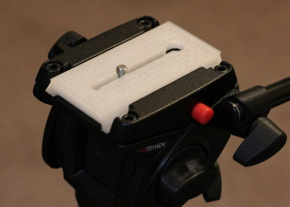
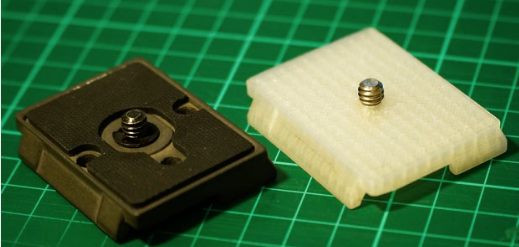
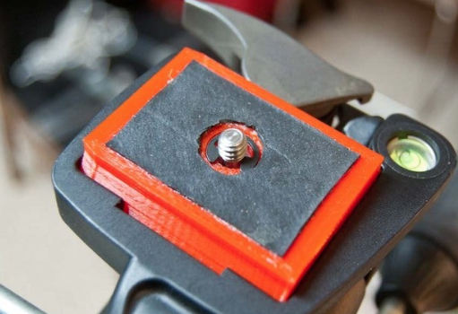
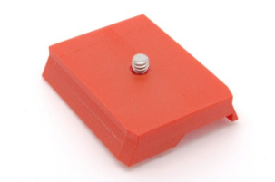

# Todo: Consider the available 3D printable Manfrotto camera mounts for my DIY Teleprompter triped mount?

```#ffc78e36``` *As of 2020-10-25 20:24*

[mail plain/text](mail.txt)


I want to make an iPad based teleprompter so I need some way to mount it to my Manfrotto Tripod camera head :)

==&gt; Also see "[Todo: Build my own teleprompter :)](../2ed17157/chime.md)"

==&gt; Also see "[Todo: Consider to write a teleprompter app for Android (Chrome)?](../5d76445d/chime.md)"

==&gt; Also see "[Todo: Consider we can use the glass from foto frames to build a 3D printer enclosure and a Phone/Tablet based Teleprompter?](../48e4e2ce/chime.md)"

==&gt; Also see ""

1) It seems there are many options in Thingiverse to 3D print the camera mount piece that fits the Manfrotto tripod camera head?

==&gt; Consider Thingiverse "Manfrotto 501PL-compatible quick release plate" (<https://www.thingiverse.com/thing:7649> )?

>   
> *This piece fits Manfrotto video head but will fit also the camera head?*

==&gt; Consider Thingiverse "Manfrotto 200PL" (<https://www.thingiverse.com/thing:1916224> )?

>   
> *Printable 3D model of Manfrotto 200PL camera mount plate*

==&gt; Consider Thingiverse "Manfrotto 200PL" (<https://www.thingiverse.com/thing:246855> )?

>   
> *A printable 3D model from 2014 for Manfrotto PL200*

==&gt; Consider Thingiverse "Compact 501 Quick Release Plate (Manfrotto/Bogen)" (<https://www.thingiverse.com/thing:153978> )?

> 

...


